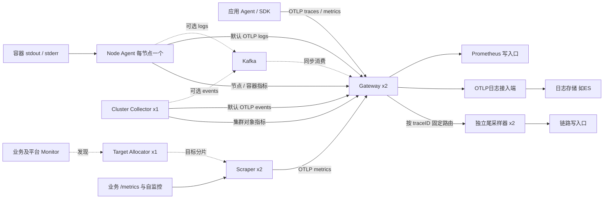
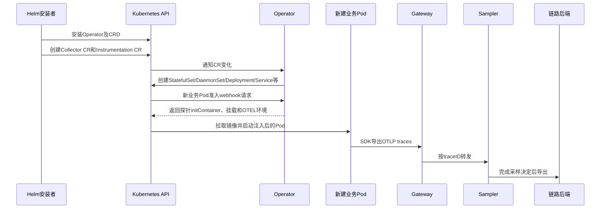

# OpenTelemetry 采集与处理架构（0.7.4）

本文描述交付包实际生成的资源、pipeline、配置接口和恢复边界。安装主线在 [部署文档](02-部署文档.md)；本次验证范围见[版本验证](#版本验证)。源码、values和打包产物一同交付，不依赖生成脚本安装。


## 阅读导航

- 初学者先看[基本概念](#基本概念)、[总体架构](#总体架构)、[业务配置](#业务配置)与[连接和证书](#连接和证书)。
- 理解数据怎么走，看[三信号pipeline](#三信号原理)、[尾采样](#尾采样)、[指标发现](#指标发现)。
- 做生产容量、运维、变更，看[资源与恢复](#容量与恢复)、[安全边界](#安全边界)、[生产运维](#生产运维)、[故障演练](#故障演练)。
- 百度云/AWS适配看[云环境](#云环境)，参数与文件关系看[交付结构](#交付结构)。
- 实际安装按[部署文档](02-部署文档.md)，不需要先理解本文全部实现细节。

<a id="基本概念"></a>
## 0. 先分清三要素、采集层和后端

| 名词 | 在本方案中的含义 | 不代表什么 |
| --- | --- | --- |
| Trace / span | 一次调用链及其中的一段操作；通过traceID、spanID、parentSpanID关联 | 日志里出现ERROR不等于span状态ERROR；未埋点的操作不会自动出现 |
| Metrics | 一段时间内的计数、耗时分布、CPU、内存、对象状态等数值 | 不是每次请求都保存一份完整原始记录；业务指标需应用或exporter实际提供 |
| Logs | 应用stdout/stderr以及Kubernetes事件 | 不会默认读取应用任意文件或替应用生成日志 |
| OTLP | OTel传输协议，支持HTTP/protobuf及gRPC | 不是ES Bulk、Prometheus查询API或Prometheus文本`/metrics`协议 |
| Collector | 接收→处理→输出数据的进程 | 发送队列不是长期查询数据库；Collector本身不提供完整监控看板 |
| Operator | K8s控制器，根据CR创建Collector/TA并注入探针 | 不处在每条遥测数据的转发路径中 |
| Instrumentation CR | 注入用的探针镜像、endpoint、sampler和环境配置 | 只创建CR不会给已运行的应用Pod自动热加载探针 |
| PodMonitor / ServiceMonitor | 描述哪些Pod/Service的哪个端口提供Prometheus指标 | 不会给应用创造`/metrics`，也不是指标存储 |
| PVC / StorageClass | PVC申请持久存储，StorageClass决定由哪个CSI/哪类云盘供应 | PVC不是对象存储桶的同义词，也不自动决定队列的逻辑容量 |
| CA / ServiceAccount | CA验证HTTPS服务证书；ServiceAccount token用于向K8s/kubelet证明身份 | CA不是云账号密钥；有可信证书也不等于有RBAC权限 |

**采集平台安装好**和**业务接入成功**是两件事。平台Ready后，服务仍需探针/SDK实际产生trace和metrics、输出日志；后端仍需接收并保存。最终以三类数据可查为准。

本方案的通用边界在OTLP与Prometheus写接口。换成另一个兼容后端通常改endpoint、协议、认证/CA即可；换成不兼容协议、改变队列类型或拓扑时，属于接入适配/迁移，不能承诺只换URL。

<a id="总体架构"></a>
## 1. 总体架构与职责



每个集群独立部署、使用唯一稳定cluster_name。多个集群可共用后端，但查询与告警必须保留集群维度。

| 组件 | 默认形式/数量 | 职责及可用性边界 |
| --- | --- | --- |
| Operator | Deployment/1 | 管理CR、创建Collector/TA、新Pod注入。已有Collector不依赖它逐条转发；故障会影响注入、协调。不能安装多套管理相同资源的Operator |
| Gateway | StatefulSet/2 | 接入、元数据/脱敏、指标标签、日志出口、traceID路由；PVC保存发送队列 |
| Sampler | StatefulSet/2 | ERROR/慢链路/概率尾采样；每个trace归属一个分片，两个实例不是同一trace的两个副本 |
| Node | DaemonSet/每Linux节点一个 | 容器文件日志、hostmetrics、kubeletstats；checkpoint/队列在独立hostPath |
| Cluster | StatefulSet/1 | 集群对象状态与Events；单实例避免重复采集，有故障恢复窗口 |
| Scraper | StatefulSet/2 | 执行TA分配的Prometheus抓取；PVC保存输出队列，副本之间为分片关系 |
| TA | Deployment/1 | 发现Monitor/静态job、分配目标；短暂故障会影响发现与重分配，不是指标存储 |

本交付不安装存储、查询、看板或告警平台；不自动覆盖控制平面、数据库、中间件、自定义业务指标或服务图。`k8s_cluster`不是kube-state-metrics同名指标全集，hostmetrics也不保证兼容所有node-exporter看板。

这些组件和[Agent/Gateway模式](https://opentelemetry.io/docs/collector/deploy/gateway/)属于上游支持的部署方式。平台chart是本方案维护的封装，不是上游官方发行的一整套生产配置。filelog、tail_sampling等组件在固定上游版本仍标记Beta；生产使用必须锁版本并回归。


### 1.1 控制面、数据面和资源所有权



1. 官方Operator chart负责Operator、Webhook和OTel CRD；平台chart不是另一套Operator。
2. 平台chart负责各角色的Collector CR、两个Instrumentation CR、SA/RBAC、Secret、自监控Monitor、NetworkPolicy和Sampler headless Service，并归档Monitor CRD。
3. Operator把Collector CR协调成实际工作负载、配置和普通Service。Pod名称中带`-collector`；TA从Scraper CR生成。
4. StatefulSet依据volumeClaimTemplates创建每Pod独立PVC，Node则挂自己的宿主状态目录。两者不要混为一个共享磁盘。
5. 更新源values后用Helm更新CR。不要直接编辑Operator生成的Pod/StatefulSet/ConfigMap，它们可能被重新协调覆盖。
6. `upgradeStrategy: none`不等于禁止配置更新；它避免把Collector镜像升级交给Operator默认自动处理，镜像由固定values管理。

平台chart有固定资源名，如`otel-gateway`、`otel-node`和`standard`。同一namespace不要装第二个release企图复用这些名字；生产同一集群也不要无意部署两套Node/Cluster采集造成重复。复用已有Operator先核对CRD、版本、证书、管理范围及资源所有权。

默认Webhook `failurePolicy: Ignore`：Webhook故障时业务Pod可能继续创建但**没有探针**。已有Collector可继续运行，新Pod注入及配置协调受影响。以实际initContainer、环境和数据判断注入成功。

<a id="连接和证书"></a>
### 1.2 连接关系、端口和三类CA

以下都是调用方向。具体云安全组、网格或NetworkPolicy要按该方向放行；本chart不管理云网络资源。

| 发起方 | 目标 | 用途/默认端口 | 信任与认证 |
| --- | --- | --- | --- |
| 业务SDK | `otel-gateway-collector.observability.svc` | OTLP HTTP4318或gRPC4317 | 当前可信内网明文，不配置业务入站认证 |
| Node/Cluster/Scraper | Gateway普通Service | OTLP gRPC4317 | 内部明文；日志dual模式改发`otel-logs-collector` |
| Gateway | Sampler固定ordinal DNS | OTLP gRPC4317 | 固定traceID路由，内部明文 |
| Sampler | trace_endpoint | 采样后traces；端口由后端决定 | TLS验证与TRACES_AUTHORIZATION |
| Gateway/独立logs | log_endpoint | OTLP logs | TLS验证与LOGS_AUTHORIZATION |
| Gateway | metrics_endpoint | OTLP或Remote Write | TLS验证与METRICS_AUTHORIZATION；AMP可用SigV4 |
| Node | 自己的节点地址 | kubelet HTTPS10250，采容器指标 | kubelet CA/SAN + SA token + nodes/stats权限 |
| 各需元数据角色/TA | Kubernetes API | HTTPS，端口按集群Service | Pod内SA CA、token和RBAC |
| Scraper | TA | 默认Service80，读取目标分配 | 默认集群内HTTP；认证Monitor场景另启用TA mTLS |
| Scraper | 被抓取目标 | 应用命名metrics端口、Collector8888、TA8080等 | 依Monitor/job定义，不自动开放应用端口 |
| Scraper | Operator Service | 自监控HTTPS8443 | Operator公开CA、TLS server_name、SA bearer token |
| Kubernetes控制面 | Operator Webhook Service | Pod准入/CR webhook HTTPS，按实际Service与targetPort | Webhook CA bundle、服务证书，需控制面可达 |
| Pod | DNS/镜像仓库 | 服务解析、拉取应用/探针镜像 | DNS网络、仓库凭据和镜像架构需实际可用 |

本文固定示例平台namespace为observability；真实模板的Service DNS随release namespace生成。默认不暴露公网Ingress/LoadBalancer业务入口。

三种证书用途分开：

- `backend_ca_file`：校验三类后端的服务器证书；空值使用系统信任库，私有根放trust Secret。
- `kubelet_ca_file`：校验节点kubelet服务器证书，默认Pod内ServiceAccount CA；实际签发CA或SAN不同须调整。K8s API的CA可信不必然意味着同一CA签发所有kubelet证书。
- `operator_metrics` CA：Scraper安全抓取Operator的自监控。默认安装时从Operator Secret读取公开`ca.crt`并复制到平台trust Secret；不需要提取私钥。离线渲染无lookup结果时显式提供CA。

`x509`涉及证书链、地址/SAN、有效期和CA；401/403涉及身份/权限；超时还需查DNS、路由和策略。不要把所有问题都用关闭TLS验证处理。`trace_headers/log_headers/metrics_headers`加在**平台到后端**的请求上，不能当作应用到Gateway的入站认证。

### 1.3 多副本、调度与可用性

默认Gateway/Sampler/Scraper各2副本，采用按节点hostname的拓扑分布约束；实际跨节点/可用区落点还取决于可调度节点、污点、资源和云盘拓扑。两个副本并不自动保证跨可用区容灾。

- Gateway是多入口，Service可分配请求到任一实例；各自队列独立，没有自动队列复制。
- Sampler是按traceID分片，不是同一trace的双份副本；同一trace在单个Sampler组装。Pod换IP通过固定ordinal DNS恢复，不自动改路由环。
- Scraper是按目标分片，TA帮助避免两个实例对同一目标持续重复抓取；重分配期间的间隙/重叠与后端乱序仍需监控。
- Cluster和TA默认单实例。Cluster避免重复对象/事件采集；TA故障会影响目标发现和再分配。已有分配/抓取的实际持续行为依赖缓存、重试和故障时长，不能承诺无限期不受影响。
- Gateway/Sampler/Scraper默认PDB允许最多1个不可用；Cluster单副本minAvailable=0。Operator自带PDB默认关闭。PDB主要约束自愿驱逐，不能防止节点宕机、OOM或强制删除，也不保存尾采样内存。

外层持久路由队列默认单消费者。目标Sampler故障后重试会占用发送工作，健康分片也可能受背压影响；有磁盘队列意味着有界缓冲，不意味着所有分片不中断。恢复/扩缩采样器要按固定环、队列与待决窗口一起规划。

<a id="三信号原理"></a>
## 2. 数据链路与全部 pipeline

以下是默认direct + unified + OTLP HTTP的实际顺序。`resource/extra`仅在配置resource_attributes时插在resource/node或resource/cluster之后。

| 角色/信号 | receiver → processors → exporter |
| --- | --- |
| Gateway traces | otlp → memory_limiter → k8s_attributes → resource/cluster → 可选filter/trace_noise → transform/trace_resource → attributes/redact → load_balancing/traces |
| Sampler traces | otlp → memory_limiter → resource/cluster → tail_sampling → otlp_http/traces（持久队列） |
| Node logs | filelog → memory_limiter → k8s_attributes → filter/log_opt_in → resource/node → transform/log_json → otlp/logs（持久队列） |
| Gateway logs | otlp → memory_limiter → resource/cluster → otlp_http/logs（持久队列） |
| Node metrics | hostmetrics + kubeletstats → memory_limiter → resource/node → otlp/metrics（持久队列） |
| Cluster metrics | k8s_cluster → memory_limiter → resource/cluster → otlp/metrics（持久队列） |
| Cluster events | k8s_events → memory_limiter → resource/cluster → otlp/logs（持久队列） |
| Scraper metrics | prometheus（TA分片）→ memory_limiter → resource/cluster → otlp/metrics（持久队列） |
| Gateway metrics | otlp → memory_limiter → k8s_attributes → resource/cluster → transform/metric_labels → otlp_http/metrics（持久队列）或prometheus_remote_write（专用WAL） |

Collector内部组件名带后缀只用于区分实例。当前采用的`otlp`是固定版本支持的兼容名称；上游会提示其gRPC exporter别名弃用，不代表该版本配置不可运行。后续升级应根据新版本迁移并重跑测试。

### 2.1 Kafka模式

`logs_transport: kafka`只改变日志/事件中间传输：

- Node logs和Cluster events输出Kafka，仍先进入各自持久队列。
- 日志Gateway从Kafka读OTLP protobuf，而非原始文本。
- Kafka receiver：initial_offset=earliest、提交间隔1s、after=true、on_error=false、on_permanent_error=false；失败不提前确认。
- 日志后端exporter禁用异步发送队列；没有在Kafka确认之前插入batch processor。后端成功才允许调用返回成功。
- Kafka生产acks=all、zstd、禁止自动建topic；接入账号、分区、ACL、消息上限及retention由Kafka管理员配置。
- `kafka_metrics.enabled`只允许在Kafka传输模式启用，额外查询需要权限。

重试、提交和崩溃可产生重复；部分成功或永久坏消息仍需处置。设计目标是有限容量内的可恢复传输，不承诺exactly-once。ES Bulk部分失败也要检查单文档结果，不能只以HTTP200认定全部成功。

### 2.2 unified与dual

`gateway_topology: unified`共用Gateway处理日志/指标/trace入口；尾采样始终独立。Kafka不隔离共享Gateway内的CPU、GC、网络争用。

`dual`将日志放到独立otel-logs：direct时为StatefulSet+PVC；Kafka时为Deployment，因为消费后同步写后端，不需要额外异步日志队列。业务OTLP traces/metrics始终发otel-gateway，不直接发Sampler。

| 拓扑/日志传输 | PVC个数 | 说明 |
| --- | --- | --- |
| unified/direct或kafka | 7 | Gateway2 + Sampler2 + Scraper2 + Cluster1 |
| dual/direct | 9 | 上述7个 + logs2 |
| dual/kafka | 7 | logs Deployment不建PVC |

数量按默认副本计算；Node hostPath另计。只有测到共享资源争用时才拆分，不为组件数量本身增加复杂度。

<a id="尾采样"></a>
## 3. 尾采样的准确语义

Java/Python/Node.js和SDK环境注入均使用always_on；应用侧头采样丢弃的span无法由尾采样补回。手工SDK、代码内sampler、环境覆盖、已有APM和外部上游仍须逐项检查。

Gateway完成Kubernetes关联与脱敏，再用load_balancing的traceID固定哈希路由。同一trace经不同Gateway仍须到同一Sampler。固定端点是：

```text
otel-sampler-collector-0.otel-sampler-headless.<namespace>.svc:4317
otel-sampler-collector-1.otel-sampler-headless.<namespace>.svc:4317
```

所有Gateway必须使用同一端点集合。显式headless Service与Sampler的serviceName对应；publishNotReadyAddresses仅保证启动期DNS可见，不代表未Ready可成功接收。普通Service不能替代按ordinal的路由。Pod换IP不改变固定哈希端点，故障时该分片会积压；不自动切到另一个Sampler，否则正在组装的trace可能被拆开。

### 3.1 默认策略

策略取OR：任意span status.code=ERROR、完整已收到trace的最早开始到最晚结束至少2000ms、或约10%概率命中，即保留。

```yaml
tail_sampling:
  decision_wait: 30s
  num_traces: 10000
  expected_new_traces_per_sec: 0
  maximum_trace_size_bytes: 5242880
  decision_cache:
    sampled_cache_size: 100000
    non_sampled_cache_size: 100000
  policies:
    - name: errors
      type: status_code
      status_code: {status_codes: [ERROR]}
    - name: slow
      type: latency
      latency: {threshold_ms: 1999}
    - name: baseline
      type: probabilistic
      probabilistic: {sampling_percentage: 10}
```

**为什么是1999：固定上游版本latency按整数毫秒计算并使用严格`>`，所以1999实现至少2000ms。** 已用1999/2000/2001ms运行边界验证。不要误改成2000后仍声称包含恰好2秒。

ERROR是span状态，不是任意包含“error”的文本。SDK未把HTTP500标成ERROR时，需修正埋点或按真实语义增加策略。普通10%不是每十条固定保留一条。

30s从首个收到的span开始，不是请求结束后再等30s。晚到的错误span可能继承已缓存的丢弃决定。等待时间须覆盖实际长请求、异步任务和传输延迟；越长，内存需求越大。

### 3.2 内存和故障边界

- 待决trace与决策cache默认在内存，不受exporter磁盘队列保护。崩溃、重启、滚更可能丢失待决数据。
- num_traces限制条数，不是字节。单trace超过5MiB会被丢弃以保护内存；监控超限、提前淘汰和决策耗时。
- 初始Sampler两副本、每个4Gi上限，不是200服务容量承诺。按全量新trace/s×等待窗口×余量核算条数，再按真实span大小/数量测RSS。
- 路由外层持久队列保存未送达请求；内层OTLP禁用异步队列、有界调用、外层负责重试。故障端点仍可能占用重试worker并造成背压，不能称无损自动故障切换。
- 采样后入队的数据可按持久卷恢复。待决状态、SDK尚未导出的内存数据、永久坏记录不在此保证范围。
- 不配置Sampler HPA。副本变化改变哈希环，须按维护流程控制新流量、排空路由队列并考虑等待窗口；无法承诺变更期间每条trace完整。

详见[固定版本tail_sampling](https://github.com/open-telemetry/opentelemetry-collector-contrib/blob/v0.163.0/processor/tailsamplingprocessor/README.md)和[load_balancing](https://github.com/open-telemetry/opentelemetry-collector-contrib/blob/v0.163.0/exporter/loadbalancingexporter/README.md)。

<a id="业务配置"></a>
## 4. 业务接入与日志处理

### 4.1 注入、选择和资源身份

原生annotation值使用`observability/standard`；已有/metrics使用`observability/standard-prometheus`。后者关闭SDK metrics，不关闭trace。两者SDK logs都关闭，避免与stdout重复。

同语言namespace可设置原生注入annotation，但只影响新Pod；混合语言优先逐Deployment灰度。停止注入时Pod模板明确设对应annotation为`"false"`再滚动，仅删除可能仍继承namespace默认值。只采日志使用Pod或namespace label `observability.example.com/enabled: "true"`；Pod同名label为`"false"`优先停采日志。

有效Java/Python/Node.js/SDK注入annotation也会选中该Pod日志。opt-in决定导出，不是宿主文件访问隔离：未选中文件仍可能先被读取解析。平台namespace默认排除；`log_namespaces`非空时只读取这些namespace路径，主要用于受控范围采集和隔离测试。

建议所有服务固定`app.kubernetes.io/name`与version；不要把Pod名作为逻辑服务名。集群/环境来自values，实例、Pod UID等由SDK或采集器保留。上游支持的库能自动产生span；自定义协议、异步传播、自定义业务指标仍需埋点。

### 4.2 filelog和应用多行堆栈

receiver内部顺序为container parser → 文件+stdout/stderr分源 → 按来源可选recombine → 删除临时源字段，之后才进入processors。

- container parser识别CRI/Docker外层时间/流/路径，恢复CRI P/F分片；这与应用堆栈合并不是一件事。
- 单行JSON内转义换行本来是一条事件，无需额外recombine。
- 多行文本默认不合并。先确认真实首行格式，再按namespace/container等路径信息开启，避免把独立日志错误拼接。

例如orders-prod的app容器使用日期首行，在集群values追加：

```yaml
log_processing:
  filelog:
    recombine:
      if: 'resource["k8s.namespace.name"] == "orders-prod" and resource["k8s.container.name"] == "app" and not (body matches "^[[:space:]]*[{]")'
      is_first_entry: 'body matches "^[[]?[0-9]{4}[-/][0-9]{2}[-/][0-9]{2}[ T]"'
```

该阶段只能使用路径解析的namespace/Pod/container，不能使用稍后API补充的Deployment label。原始Python traceback、Go panic等不能直接套日期规则。

默认128源、128行、262144字节触发刷新、1s强制刷新。达到阈值会拆分；按文件和输出流隔离。缓存早于memory_limiter且未写WAL，进程崩溃可能丢未刷片段。增加源数/上限要重新预算Node内存。

filelog默认beginning，已有checkpoint优先。新容器启动日志可以保留，首次安装也会读取仍在磁盘的历史文件，须预算接入突增。轮转删除、Pod元数据过期和节点永久丢失会限制补采。

### 4.3 日志时间、级别、ID与脱敏

推荐应用输出：

```json
{"timestamp":"2026-10-22T12:00:00.123+08:00","level":"ERROR","message":"inventory timeout","trace_id":"0123456789abcdef0123456789abcdef","span_id":"0123456789abcdef"}
```

处理器支持JSON常见trace_id/traceId/otelTraceID/trace.id及span对应别名和嵌套trace.id/span.id；支持命名明文字段、完整`[trace,span]`对及traceparent。只提升合法非零32/16位hex到原生字段，不凭空生成关联ID。

支持字符串level/levelname、Pino数字级别10/20/30/40/50/60，以及明确日期首行文本级别。JSON timestamp/@timestamp/time支持带时区RFC3339字符串；未知格式保留容器时间。无时区文本按真实layout/timezone显式启用application_time，例如Asia/Shanghai。数字epoch或任意自定义格式须另定规则。

Java MDC、Python handler/formatter、Node logger和Go context logger须实际输出ID。采样丢弃trace后，日志中仍可能有合法ID而查不到对应trace。

日志归一化保留结构化body，只删除列出的顶层password/authorization/cookie。trace删除列出的Authorization/Cookie、db.statement/db.query.text、url.full/url.query/url.fragment、旧版http.url/http.target及http.request.body/http.response.body属性；保留独立url.path、http.route、server.address等定位字段。删除完整URL可能减少旧埋点的定位信息，业务应提供安全的路由/路径字段。此规则不扫描URL路径中的个人信息、span事件、任意嵌套JSON或自由文本；按实际业务字段补充脱敏，应用侧避免输出秘密。


### 4.4 annotation、label与三要素的准确关系

| 配置 | Trace | SDK metrics | 容器stdout/stderr日志 |
| --- | --- | --- | --- |
| 有效Java/Python/Node.js注入 + standard | 支持的库/框架自动埋点 | SDK及支持库实际产生的指标 | 被Node opt-in选中 |
| 同上 + standard-prometheus | 保留 | 关闭注入SDK的metrics；另配/metrics抓取 | 被选中 |
| inject-sdk（如Go） | 只有应用初始化SDK及埋点后才有 | 只有实际初始化/记录后才有 | 有效注入标记可被选中 |
| 仅observability.example.com/enabled=true | 不生成 | 不生成 | 被选中 |
| 仅app.kubernetes.io/name | 不生成 | 不生成 | 只提供服务身份，不单独启用采集 |

annotation放在Deployment的`spec.template.metadata.annotations`；普通label在`spec.template.metadata.labels`。修改模板会随正常发布创建新Pod。只给顶层Deployment metadata加注解，不会注入其Pod。

自动埋点覆盖的是上游支持的库与框架，不覆盖任意业务函数。跨服务要传播W3C tracecontext；业务自建HTTP客户端、MQ/异步、线程切换和非标准协议须检查传播。Go不启用eBPF，inject-sdk主要提供endpoint/resource/sampler等环境，代码必须使用这些设置初始化对应SDK。

注入配置默认OTLP HTTP/protobuf，应用发往Gateway4318。`standard`打开SDK metrics；`standard-prometheus`将注入的metrics exporter设none；两者日志exporter均none，由Node读stdout避免双份。默认SDK metrics累计temporality、周期60s、BSP queue2048、export batch128、属性值长度4096。这些是有界内存设置，不是应用退出时的磁盘保护；应用应按语言SDK正确结束/flush，探针额外内存需纳入业务Pod预算。

生产logger的MDC/formatter仍需配置。能在后端找到日志，与能点击日志跳转trace是两次验收：前者验证采集，后者需要合法ID被解析成原生字段且对应trace被保留。尾采样丢弃的trace仍可能留下带ID日志，这是正常边界。

部署文档提供现有Java服务的接入及验收步骤；[独立Java验证](#独立Java验证)提供完整Deployment、接口调用和查询命令，使用公司批准的Java17/21镜像验收实际业务及跨服务传播。交付不包含演示应用，不能据此宣称任意框架零代码可用。

### 4.5 Java 17/21 + Spring Boot 3：三条独立数据路径

1. **Trace**：Operator为新Pod加入initContainer，复制Java agent并向`JAVA_TOOL_OPTIONS`追加`-javaagent`。探针为支持的Servlet/Spring MVC、HTTP client、JDBC等库埋点，通过OTLP HTTP发往Gateway；Gateway按traceID固定路由到Sampler，Sampler决策后发往trace后端。无需在业务代码初始化第二个SDK。跨服务正确性要核对同一traceID、parentSpanId和ERROR/慢请求，而非只看有几个span。
2. **Logs**：探针提供MDC上下文，Logback实际把ID写进stdout，Node按CRI读取并解析；JSON字段或文本ID被提升为原生trace/span字段，经日志处理、持久队列发往日志后端。Java logs exporter保持none，避免与filelog重复。推荐单行JSON；文本异常堆栈必须针对实际Pod配置首行规则，多行合并发生在元数据API补充之前。服务启动日志没有活动span时，ID为空属于正常现象。
3. **Metrics**：探针产生受支持的JVM/HTTP等指标，应用业务Counter由代码使用OTel API记录；SDK累计值按周期送Gateway，再转为公司后端选择的OTLP或remote_write。自定义业务Counter不能靠annotation推导。是否把`service.name`等resource提升为Prometheus标签，由后端接收配置决定；查询时要核对实际标签和单位，不能把resource与数据点属性混为一谈。

已验证的应用固定Spring Boot 3.5.16，使用Java 17字节码，在JRE 17/21上运行。本地kind历史验证使用Java17 Logstash JSON及Java21文本多行堆栈；本次new-dev验证两套Java均输出Boot原生Logstash JSON（含单行`stack_trace`）。日志形态由Deployment环境变量控制，两种验证范围在[版本验证](#版本验证)区分。H2验证自动JDBC span，自定义Counter使用固定`test_case`标签，唯一请求标记只出现在span/日志中，避免指标高基数。

历史本地kind验证用debug和file exporter逐字段断言，并查询临时Prometheus；new-dev本轮则写入真实Prometheus、Elasticsearch和Tempo后查询验收。两者均未把生产默认出口改为debug。debug不能代替后端落库，也不用于生产高流量数据出口。

跨线程、`@Async`、自建Executor、WebFlux/Reactor、Kafka/RabbitMQ、Redis/MySQL、其他数据库驱动以及真实公司Boot小版本，需要用真实服务单独回归。SDK/agent兼容、业务日志格式正确、后端协议/认证正确，是三项独立条件。

<a id="指标发现"></a>
## 5. 指标来源、发现与重复采集

| 来源 | 默认周期 | 边界 |
| --- | --- | --- |
| SDK | 60s cumulative | JVM/进程/支持库指标因语言不同；自定义业务Counter/Histogram要埋点 |
| hostmetrics | 30s | CPU、内存、load、磁盘、网络、文件系统；排除伪文件系统和容器挂载路径 |
| kubeletstats | 30s | pod/container/volume；CA/SAN、10250网络和nodes/stats权限必须正确 |
| k8s_cluster | 30s | Deployment等对象状态、request/limit、节点条件/allocatable；不是控制平面全部指标 |
| Prometheus抓取 | Monitor/job决定 | 端口/path/selector/认证正确，TA分片避免多个Scraper重复采同一目标 |
| 自监控 | 30s | Collector/TA经Monitor；Operator经HTTPS、公开CA/SAN及SA token安全抓取 |

现有node-exporter/kube-state-metrics/云监控可复用；决定每类指标的唯一采集路径，不为统一OTel而重复采集。同一业务指标族选SDK或/metrics；注入standard-prometheus只关闭注入SDK的metrics，代码内初始化仍需确认。

PodMonitor例：

```yaml
businessPodMonitors:
  - name: inventory-api
    namespace: business-prod
    spec:
      selector:
        matchLabels:
          app.kubernetes.io/name: inventory-api
      sampleLimit: 20000
      targetLimit: 200
      labelLimit: 64
      podMetricsEndpoints:
        - port: metrics
          path: /metrics
          interval: 30s
          scrapeTimeout: 10s
```

业务须真正暴露命名metrics端口；namespace须存在。chart添加owner=otel并合并基础身份relabel。已有Monitor加owner label可复用；monitor_namespace_selector同时限制四类Monitor发现范围。sampleLimit超限会使该次抓取失败，不是只截取前20000条。

现有Prometheus若全选Monitor，新增Monitor也会被它发现。先协调发现范围和写入目标，防止重复；本平台不能替其他系统排除测试/业务Monitor。

`monitor_resources_enabled: false`不创建平台/业务Monitor，并关闭TA的prometheusCR发现；`scrape_jobs`可传入原生Prometheus scrape_configs，由TA唯一分配。new-dev隔离测试采用此模式。关闭Monitor时不允许同时填写businessPodMonitors。

### 5.1 认证Monitor

Secret权限不等于凭据能安全交付。使用basicAuth/authorization/OAuth/bearerTokenSecret的Monitor，需要TA mTLS；本包可透传上游target_allocator_mtls，证书由公司PKI或已有cert-manager提供。

```yaml
target_allocator_mtls:
  enabled: true
  useCertManager: false
  tls:
    certificateAuthorityCertificate:
      configMap: {name: otel-ta-ca}
    serverCertificate:
      certificateSecret: {name: otel-ta-server}
      keySecret: {name: otel-ta-server}
    clientCertificate:
      certificateSecret: {name: otel-ta-client}
      keySecret: {name: otel-ta-client}
target_allocator_secret_namespaces: [business-prod]
```

证书SAN需覆盖TA Service DNS，客户端具备clientAuth；Secret key默认tls.crt/tls.key，CA key为ca.crt。其他namespace只按显式列表授权；不为消除报错授予全局Secret读取。TA证书subPath挂载，轮换要重启相应工作负载。具体要求以[固定版本TA说明](https://github.com/open-telemetry/opentelemetry-operator/blob/v0.161.0/docs/target-allocator/README.md)为准。

### 5.2 指标标签和写入顺序

Gateway按白名单把Resource属性复制到指标数据点，已有同名点标签不覆盖：

| 维度 | 数据点标签 |
| --- | --- |
| 集群/环境 | k8s_cluster_name、deployment_environment_name |
| namespace/Pod/节点 | k8s_namespace_name、k8s_pod_name、k8s_node_name |
| 服务 | service_name、service_namespace |
| 容器/卷 | k8s_container_name、k8s_volume_name |
| 工作负载 | k8s_daemonset_name、k8s_statefulset_name、k8s_replicaset_name、k8s_job_name、k8s_cronjob_name、k8s_hpa_name |

这些标签用于避免不同资源在后端成为同一时间序列。保留实例身份和业务维度，不展开所有Pod label，不添加trace_id/用户ID为指标标签。

多Gateway、TA重分配、队列重放会带来乱序。Prometheus须验证接收接口、乱序窗口、名称/单位/直方图/累计temporality和job/instance映射。Prometheus receiver把job/instance等转换为OTel资源后，后端OTLP接收可能再生成不同job标签；验收查询应先检查实际标签，不能凭原scrape job字符串猜测。

<a id="容量与恢复"></a>
## 6. 资源、存储与恢复

内存参数C（MiB）联动：Pod limit=C、request=floor(C/2)、limiter硬阈值H=floor(0.8C)、spike=floor(0.2H)、软阈值/GOMEMLIMIT=H-spike。每条pipeline以memory_limiter开头。GOMEMLIMIT是Go软限制，不覆盖全部RSS或瞬时分配；receiver合并缓存、尾采样和大记录都需留余量。

默认持久发送队列每exporter为256MiB逻辑容量、fsync开启、满后背压。队列持久化后有界分批，8KiB起发、最大512KiB、200ms刷新。单个不可拆记录仍受请求限制；OTLP默认4MiB，filelog单条256KiB、并发64文件。queue容量不是PVC实际文件大小保证。

Remote Write使用独立1000请求队列和WAL，不遵循exporter_queue_mib；WAL须监控磁盘，乱序及故障恢复按实际后端验证。日志出口仅支持OTLP；Kafka消费后的OTLP日志出口同步，不开启异步queue。普通ES Bulk入口不能直接配置，须由后端提供可靠OTLP接入端，见部署文档。

24个Linux节点、默认unified拓扑时，平台requests约8.5CPU/20.75GiB，另加Operator0.2CPU/256MiB。应用agent和后端不在此预算。200服务不能直接换算资源。

| 故障点 | 保护 | 不保护的范围 |
| --- | --- | --- |
| 应用到Gateway | SDK有界内存队列、重试 | 应用退出、SDK队列满、未生成/未上报的数据 |
| 文件到Node队列前 | 容器文件与checkpoint | 轮转清理、删除Pod元数据、未刷堆栈缓存 |
| Node hostPath | 持久队列/checkpoint | 节点永久丢失、磁盘损坏/耗尽 |
| Gateway到Sampler | 路由外层持久队列 | 已被Sampler接收的待决内存、有限容量耗尽 |
| Sampler决定后到后端 | PVC持久队列 | 未决状态、超大trace、提前淘汰 |
| Kafka到后端 | 失败不提前确认，积压留Kafka | retention到期、部分成功、永久坏消息；可能重复 |
| 抓取到Gateway | 发送端持久队列 | 抓取端故障期间未采集的历史样本无法以后补抓 |

容量表至少记录：峰值新trace/s、spans/trace、bytes/span、日志bytes/s、指标points/s/活跃series、可接受故障窗口、磁盘及网络吞吐。队列粗算输入bytes/s×故障秒数×余量；tail数量粗算每分片新trace/s×等待秒数×余量。恢复速度必须大于持续输入才会追平。上述公式不是性能实测替代。


### 6.1 每种状态保存在哪里

| 状态 | 所在位置 | 重启后的行为 |
| --- | --- | --- |
| 应用BSP/SDK metrics聚合 | 应用进程内存 | 退出/崩溃未导出部分可能丢；Collector无法补造 |
| Node文件读取checkpoint | 节点`node_state_directory`，容器内/var/lib/otel | 同节点、同状态目录可续读；没有checkpoint按start_at处理 |
| Node日志/指标发送队列 | 同一独立hostPath，按exporter分开存储 | 同节点保留文件可重放；重建到别的节点不自动迁移旧盘 |
| Gateway trace路由/日志/指标OTLP队列 | 每Pod自己的PVC，容器内/var/lib/otel | 用原PVC和兼容exporter ID可恢复；不代表其他Gateway有副本 |
| Sampler未决trace/决定cache | Sampler进程内存 | 崩溃/滚更不保留；PVC不会自动使尾采样内存持久化 |
| Sampler采样后的发送队列 | Sampler每Pod PVC | 已成功入队部分可重放 |
| Scraper与Cluster出口队列 | 各自PVC | 保存已采集但未送出的数据；停机期间未抓的样本不能事后补抓 |
| Remote Write | Gateway的专用WAL/队列 | 按该exporter机制恢复，不跟随OTLP字节队列大小 |

所有Collector的file_storage目录为`/var/lib/otel`。实现使用文件数据库，需要目录读写、锁和可靠刷盘。生产优先选合适的云块盘+文件系统；OBS/S3等对象桶不是可直接替换的队列目录。把桶通过某个驱动挂成路径也不代表已满足数据库文件语义。对象存储可由后端用于长期数据，但与采集器本地队列分层。[固定file_storage说明](https://github.com/open-telemetry/opentelemetry-collector-contrib/blob/v0.163.0/extension/storage/filestorage/README.md)

`exporter_queue_mib`是每个适用exporter的逻辑容量，不是整个Pod的磁盘上限。unified/direct Gateway有trace路由、日志、指标三个出口；Node有日志/指标两段状态，位于宿主磁盘。PVC空间还要容纳数据库文件开销和必要余量，不能用“单队列/PVC百分比”直接判断浪费。

RWO表示访问模式，不承诺云盘跨可用区立即重挂载。CSI、StorageClass的volumeBindingMode、fsGroup、卷拓扑和调度要相容；节点或可用区故障后的恢复时间需要演练。不要让两个独立Collector同时写同一队列目录。

### 6.2 默认资源与容量计算示例

| 角色 | 数量 | 单Pod CPU request/limit | 单Pod内存request/limit |
| --- | --- | --- | --- |
| Gateway | 2 | 500m / 2 | 1024Mi / 2048Mi |
| Sampler | 2 | 500m / 2 | 2048Mi / 4096Mi |
| Scraper | 2 | 500m / 2 | 1024Mi / 2048Mi |
| Cluster | 1 | 500m / 2 | 512Mi / 1024Mi |
| Node | N | 200m / 2 | 512Mi / 1024Mi |
| TA | 1 | 200m / 1 | 256Mi / 1024Mi |
| Operator（独立chart） | 1 | 200m / 1 | 256Mi / 512Mi |

默认采集层request合计约`3.7 + 0.2×N` CPU、`8.75 + 0.5×N` GiB，不含Operator与业务探针；N为实际运行Node Agent的节点数。request用于调度预算，limit用于约束，不是实测RSS/CPU。还要预留滚动、启动和重放峰值。TA内存上限参数不自动按一半重算其request，表中按真实渲染值列出。

尾采样条数按**每个Sampler新traceID到达率**×30s×余量核算，同一trace的多个服务span不要重复当作新trace。当前两个实例各10000，在均匀流量、未留余量的理想估算下约666新trace/s；不是安全TPS承诺。稳定超量可能在决定前淘汰大量trace，包括ERROR。`expected_new_traces_per_sec`是预分配提示，不会替代num_traces或创建更多内存。

尾采样观察内存/RSS、`sampling_traces_on_memory`、`sampling_trace_removal_age`、`sampling_trace_dropped_too_early`及`traces_dropped_too_large`等固定版本真实指标，核对实际暴露名/后端后缀。先做可控超量回归，再确定告警阈值，不能单看Pod Ready。

队列按**每实例、每出口**的实际未压缩数据大小与故障时长估算，再验证磁盘增长和吞吐。假设某个Gateway日志入口5MiB/s，256MiB只约51s逻辑数据；如果要求10分钟，理论就需至少3000MiB，再留余量。全局增加队列还会增加Node宿主磁盘预算。恢复吞吐必须大于新输入，才能追平。

本方案没有自动按200服务数扩容或对Sampler配置HPA。先测一个服务和代表性组合，再测峰值、后端故障与恢复；不是把内存统一改8Gi或PVC统一改50Gi就完成生产定容。

<a id="内存队列"></a>
### 6.3 可选内存发送队列

`persistent_queue` 默认 true，原有生产持久队列行为不变。false 时移除全部 exporter 的 `sending_queue.storage`，原 PVC 换成 emptyDir，gateway/sampler/scraper 等没有接收器 checkpoint 的组件移除 file_storage。node 保留 hostPath 的 filelog checkpoint；cluster 保留 emptyDir 的事件 checkpoint。该模式不依赖 StorageClass，重启会丢失未发送队列，事件 checkpoint 也不跨 Pod 重建保存。尾采样待决数据原本就在内存，此开关不改变其采样规则。已有持久队列必须先排空后再切换，不能直接以此方式迁移积压数据。


<a id="安全边界"></a>
## 7. 安全与云平台边界

每集群独立cluster_name、Kafka topic/group。可信内网中内部OTLP明文；默认namespace内允许互通，其他namespace仅能访问Gateway的4317/4318。Sampler不作为业务跨namespace入口。NetworkPolicy依赖CNI；它不是租户身份认证，也不自动配置egress/安全组/服务网格。

Node需root和hostPath，非privileged、drop ALL capabilities、只读根文件系统、RuntimeDefault seccomp；其他Collector以10001运行并使用fsGroup。hostfs只读，状态目录单独可写。Fargate、Windows、禁止宿主访问的环境不适用当前Node方案，不能用云平台名称推断节点能力。

后端和Kafka默认TLS校验，kubelet也校验CA/SAN；后端mTLS、OAuth或厂商专有接口不是默认通用URL能力。真实Secret可由外部系统创建：credentials.create=false，再设置secret_names；key必须与环境引用一致。

resource_attributes用于附加云/地域资源，不允许覆盖集群和环境。示例cloud.provider=aws/alibaba_cloud等必须按真实云平台填写；本方案不假造百度云语义枚举。AWS与百度云的存储、身份及节点限制见[云环境](#云环境)。


### 7.1 权限、Secret与当前信任边界

| 身份 | 主要权限/用途 |
| --- | --- |
| otel-gateway | 只读Pod/namespace/node/ReplicaSet元数据，关联服务与实例 |
| otel-node | 节点相关元数据及nodes/stats；Linux文件访问另外由容器/挂载权限控制 |
| otel-cluster | 只读工作负载、节点、配额、卷对象、Events等，不修改业务对象 |
| otel-scraper / otel-targetallocator | 目标发现、Monitor与相关API读取；TA默认可读平台namespace的Secret |
| otel-sampler | 专用SA；当前不启用k8s_attributes，不需要为尾采样授予业务对象写权限 |

RBAC与hostPath权限不同：RBAC允许查询API，不会自动允许读取节点文件；CA可信也不会自动授予nodes/stats。Node目前root、非privileged、drop ALL capabilities、只读根目录，但hostPath本身仍是需要授权的宿主访问。

默认managed Secret：`otel-backends`保存出口Authorization环境，`otel-trust`保存CA文件；Kafka模式再创建`otel-kafka`。Collector通过envFrom/挂载使用，不把真实后端凭据写入Collector CR明文。安装者提交的values和Helm release仍含这些秘密，需访问控制；K8s Secret不是“自动加密且谁都看不见”。

`credentials.create: false`可复用公司管理的Secret，配套secret_names与key必须匹配。内置凭据/CA变化会通过checksum触发相应Collector滚动；外部Secret环境变量不因原对象变化自动刷新，需变更rollout_revision。TA证书轮换单独按上游方式重启验收。

当前`otlp_namespace_selector: {}`允许所有namespace向Gateway提交OTLP；同平台namespace的Pod可互通。用户选择维持该默认，本文没有收紧或增加入站鉴权。NetworkPolicy需要CNI实际执行，不是namespace身份认证，不限制出站。非受信混合租户需要另行设计入站认证/TLS和限流；出口header不解决该问题。

默认外部HTTP出口只接受HTTPS，OTLP gRPC用host:port并验证证书；内部OTLP与默认TA接口仍是明文。为内部增加TLS需要同时修改接收端、全部发送端及注入环境，不能只改Gateway一处。

<a id="环境配置"></a>
## 8. 参数和最终配置检查

常改参数在values-platform.yaml，处理逻辑和tail_sampling在values-telemetry.yaml。其余默认值可通过`helm show values`查看，全部在源码values/schema中有定义。

- scheduling按gateway/logs/sampler/node/cluster/scraper设置nodeSelector、tolerations、priorityClassName；PriorityClass须预先存在。TA继承Scraper调度。
- image_pull_secrets用于采集器/TA，业务注入镜像的权限由业务namespace/ServiceAccount提供；Operator拉取参数独立在values-operator.yaml。
- service_account_annotations按SA名称附加注解，可配AWS IRSA；不会替公司创建IAM角色/权限。
- trace_headers/log_headers/metrics_headers可附加租户头。自定义密钥放credentials.backends，在headers用`${env:键名}`引用，不在Collector CR写明文。
- backend_ca_file可以指向包含多个根CA的PEM bundle。
- rollout_revision用于外部Secret轮换后触发Collector滚动。TA外部证书须单独重启验收。

离线渲染默认要先提供Operator公开CA（不提取私钥）：

```bash
kubectl --context "$OTEL_CONTEXT" -n opentelemetry-operator-system get secret \
  otel-operator-opentelemetry-operator-controller-manager-service-cert \
  -o go-template='{{index .data "ca.crt" | base64decode}}' > operator-ca.crt

helm template otel-platform ./charts/otel-platform-0.7.4.tgz \
  -n observability -f values-telemetry.yaml -f "$OTEL_VALUES" \
  --set-file 'credentials.trust.operator-ca\.crt=operator-ca.crt' \
  --show-only templates/collectors.yaml
```

点号是Secret key的一部分，必须转义；不转义会变成嵌套map。安装时默认lookup已安装Operator的公开CA。复用其他Operator须填其namespace、Service、Secret、CA和正确TLS server_name；不关闭验证。operator_metrics.enabled=false仅在已有等价自监控或隔离测试中使用。

<a id="证书适配"></a>
### 8.1 私有后端CA与kubelet适配

三个后端由公有CA签发且证书链正确时，`backend_ca_file`保持空。私有CA则在**已有字段**中填写：

```yaml
backend_ca_file: /etc/otel/trust/backend-ca.crt
credentials:
  trust:
    backend-ca.crt: |
      -----BEGIN CERTIFICATE-----
      替换为管理员提供的完整CA证书
      -----END CERTIFICATE-----
```

这是合并示意，保留原文件其他`credentials`内容。多个后端根CA可以放同一个PEM bundle。

kubelet是节点上的管理组件，Collector通过它读取容器指标。默认CA不匹配时，管理员提供实际CA，填写`credentials.trust.kubelet-ca.crt`，设置`kubelet_ca_file: /etc/otel/trust/kubelet-ca.crt`。证书只含DNS名而没有节点IP时，还要核对实际访问地址。错误中有`x509`不等于“一定只缺CA”，也可能是地址与证书不匹配、证书过期或证书链不完整。不要关闭证书校验。 kubeletstats 不支持 `server_name` 或 `server_name_override`；证书只有节点 DNS 名时设置 `kubelet_endpoint: https://${env:OTEL_NODE_NAME}:10250`。若 Pod 不能解析节点名，可在本集群覆盖文件的 `scheduling.node.hostAliases` 填对应节点名/IP；不要复制 new-dev 的地址。


节点证书仅含DNS SAN时，集群覆盖文件可采用以下结构，名称和IP必须来自目标集群：

```yaml
kubelet_ca_file: /etc/otel/trust/kubelet-ca.crt
kubelet_endpoint: https://${env:OTEL_NODE_NAME}:10250
credentials:
  trust:
    kubelet-ca.crt: |
      -----BEGIN CERTIFICATE-----
      替换为管理员确认的CA证书
      -----END CERTIFICATE-----
scheduling:
  node:
    hostAliases:
      - ip: '替换为节点IP'
        hostnames: ['替换为该节点名称']
```

只有Pod不能直接解析节点名时才需要hostAliases；为所有运行Node Agent的节点提供映射，并在节点IP变化时更新。这里的证书与Operator webhook证书不同；cert-manager可以签发/管理适用证书，但不能自动使现有kubelet改用另一套CA。

<a id="已有Operator"></a>
### 8.2 已有Operator：复用并核对信息

让平台负责人确认兼容性、管理范围和现有Monitor CRD；无需重复安装。当前平台默认抓取Operator的HTTPS自监控，因此在本集群values中覆盖这组信息：

```yaml
operator_metrics:
  enabled: true
  namespace: opentelemetry-operator-system
  service: otel-operator-opentelemetry-operator
  port: 8443
  server_name: otel-operator-opentelemetry-operator-webhook.opentelemetry-operator-system.svc
  certificate_secret: otel-operator-opentelemetry-operator-controller-manager-service-cert
```

这些是本包新装Operator的默认值；复用已有实例时按实际Service、TLS证书DNS名和包含`ca.crt`的Secret修改。已有实例可能使用其他认证/证书方式，须先适配，不能只改namespace猜地址。安装账号需要能读取相应公开CA。若公司已经有等价Operator自监控，可协调后设置`operator_metrics.enabled: false`，而不是为掩盖证书错误直接关闭。

<a id="生产运维"></a>
## 9. 自监控、故障和变更

### 9.1 必须有的告警与验收指标

采集层提供自身遥测，规则/通知配置在后端。至少覆盖：

- OOM、异常重启、内存拒收、接收/导出失败与永久失败。
- otelcol_exporter_queue_size/queue_capacity、入队失败、PVC/宿主磁盘容量及IO。
- tail_sampling提前淘汰、单trace超限、迟到跨度、决策耗时；结合版本真实指标名建立规则。
- Scraper up、目标消失、TA未分配目标、TA/Operator可用性和webhook注入失败。
- Kafka lag增长、消费者为零、retention余量（启用Kafka时）。
- 三信号新鲜度与持续canary；只有进程Ready无法发现后端长时间503。
- webhook/TA/后端证书到期。默认自签webhook365天，必须安排轮换。

k8s_cluster不提供所有kube-state-metrics同名序列；证书/PVC等指标按已有平台或适当exporter接入。共享管道故障时自身遥测也可能积压，不能把后端没有新告警当作一切正常。

### 9.2 配置更新与迁移

正常修改values再Helm upgrade。受管凭据/CA checksum触发Collector滚动；外部Secret修改需rollout_revision，TA证书轮换需按上游说明重启TA。

Operator证书默认升级复用。轮换时临时autoGenerateCert.recreate=true，升级Operator并确认就绪，保存配置恢复false，再升级平台同步公开CA。验收注入、Operator指标up、Collector运行。现有业务Pod要按发布流程重建才能采用新Instrumentation。

PVC模板的storage_class/pvc_size属于初装参数。更改values不能安全修改StatefulSet不可变模板；存量扩容按CSI/StorageClass流程，常规升级保持稳定。PVC默认whenDeleted/whenScaled=Retain，卸载/缩容不等于删除持久数据。

0.6.0升级必须专门迁移：

1. 记录现有身份、topic/group、exporter ID、队列/PVC和后端接口。
2. 旧Kafka切direct前排空旧消费积压；direct切Kafka前排空旧OTLP日志队列。不要让配置删除使旧队列失去消费者。
3. exporter HTTP/gRPC/ES/Remote Write类型变化可能改变队列目录/格式；先排空，不能指望新ID自动读取旧存储。
4. dual的日志Deployment/StatefulSet类型变化和Sampler固定路由环变化必须按维护窗口迁移，保留原PVC及补偿方案。
5. 删除head_sample_ratio，按新Instrumentation灰度重建应用Pod，检查手工SDK覆盖；不能沿用旧10%头采样并宣称错误尾采样全保留。
6. Helm rollback不恢复已删队列、Kafka offset、待决采样状态或后端数据。

故障坏消息不得为追平lag自动跳过。保留原始消息、partition/offset、错误和审计信息后，按公司审批隔离/补偿。不要把永久4xx当成加副本可解决的问题。

<a id="版本验证"></a>
## 10. 固定版本与验证证据

| 部分 | 版本 |
| --- | --- |
| 平台chart | 0.7.4 |
| 官方Operator chart / Operator / TA | 0.126.1 / 0.161.0 / 0.161.0 |
| Collector Contrib | 0.163.2 |
| Monitor CRD | 交付归档0.94.1；现有CRD不自动接管/覆盖 |
| Java / Python / Node.js探针 | 2.32.0-1 / 0.66b1-2 / 0.78.0-6 |

固定版本不自动追latest。安装只依赖交付values和两个Helm归档；测试代码与原始数据已按交付精简要求清理，以下保留已执行的验证结论及边界。

### 10.1 已执行验证摘要

2026-10-23在new-dev安装固定Operator0.161.0及平台0.7.4（Helm revision7），14个平台Pod就绪。在独立namespace运行Java17.0.20.1和Java21.0.12.1、Spring Boot3.5.16，使用相同应用字节码、真实annotation注入及独立Prometheus/Elasticsearch/Tempo验证。

| 检查 | 已验证结果 |
| --- | --- |
| Java注入与跨服务trace | Java17调用Java21，ERROR/慢/privacy链路各5个span，单根、完整父子关系及JDBC子span |
| ERROR及慢采样 | 两个服务端ERROR状态正确；慢请求至少2秒，尾采样后可查询 |
| JSON stdout日志 | 指定请求每类精确2条，原生trace/span、级别、堆栈、纳秒时间及Kubernetes身份正确 |
| 镜像身份 | 实际日志输出container.image.tags数组，Java17/21镜像标签正确 |
| JVM、业务Counter | JVM可查；每服务ok=5、error=1、slow=1、privacy=1 |
| HTTP直方图 | count、累计bucket和秒单位正确；slow sum与对应服务端span耗时差小于150ms |
| 基础设施 | 6节点容器指标新鲜，DaemonSet身份标签正确；采集日志可查 |
| 配置兼容性 | 19项Helm回归、82份Collector二进制配置、142个CRD对象及本次5份实际配置校验通过 |
| 后端查询 | 三信号写入、TLS/认证及Grafana三数据源查询通过 |

历史本地kind验证另覆盖Java21文本多行堆栈、尾采样2秒边界、路由一致性和已入队数据503/重建后重放；这些历史结果不能视为new-dev或目标云盘故障恢复已通过。

### 10.2 适用边界

本次new-dev为低流量JSON、HTTP/JDBC功能验证，使用内存队列及测试后端；没有200个真实微服务峰值、生产持久卷、长期稳定性、公司MQ/异步或任意日志格式验证。200个逻辑service.name的历史测试不等于200服务容量认证。目标集群按部署文档填参数，再用一个真实服务验证并分批接入。

<a id="云环境"></a>
## 11. 百度云与AWS适配：协议相同，基础条件逐集群确认

| 事项 | 需要确认 | 填哪里/如何处理 |
| --- | --- | --- |
| 节点类型/架构 | 普通Linux节点还是受限虚拟节点；amd64/arm64；宿主日志路径 | scheduling与镜像；Fargate/Windows/禁止hostPath环境另设采集路径 |
| 云盘 | CSI、StorageClass、RWO、fsGroup、可用区与可用容量 | storage_class/pvc_size；初装确定，故障恢复实测 |
| kubelet | 10250可达、实际CA、IP/DNS SAN、token/RBAC | kubelet_ca_file/kubelet_endpoint；由管理员给出可信信息 |
| 镜像 | 节点能访问ghcr.io等源，或需内部仓库；支持CPU架构 | collector/TA/Java/Python/Node镜像覆盖及image_pull_secrets |
| 已有监控 | 云日志、node-exporter、kube-state-metrics、Prometheus或其他OTel | 明确唯一采集路径，避免同一信号重复注入/抓取 |
| 网络 | 控制面到Webhook，Pod到API/节点/DNS/后端/仓库 | 安全组、CNI、NetworkPolicy、网格按实际连接放行 |
| 托管控制面 | 审计/控制面日志和指标由云平台开放的接口提供 | 不假设Node Agent能读到托管控制面宿主文件 |
| 后端身份 | 自建Bearer/Basic/API key，或托管服务IAM/SigV4 | 按真实接口配置，不能因“集群在AWS”自动假定用AMP |

AWS AMP确实被选为指标后端时，可在集群values配置：

```yaml
metrics_protocol: prometheus_remote_write
metrics_endpoint: https://aps-workspaces.us-east-1.amazonaws.com/workspaces/替换workspace-id/api/v1/remote_write
aws_sigv4:
  enabled: true
  region: us-east-1
  service: aps
service_account_annotations:
  otel-gateway:
    eks.amazonaws.com/role-arn: arn:aws:iam::替换账户ID:role/替换角色名
```

以上IRSA示例仅配置SA注解与签名，IAM角色/权限/信任由公司已有流程配置；EKS Pod Identity则按实际关联方式，不同时假装二者已完成。SigV4使用标准凭据链，不在values保存长期Access Key。Region、账号、workspace、权限都要实际核对；当前只有配置校验，未在公司AWS账号验收。

镜像替换同时覆盖Operator（values-operator.yaml中的repository/tag）和平台各镜像；业务namespace也必须能拉探针，不能只给observability放拉取Secret。同步后记录可信源/目标版本与digest，不改latest，不借未经核对的第三方源绕过生产网络要求。

网络检查也要覆盖镜像Blob下载域名。本次GHCR实际访问过`pkg-containers.githubusercontent.com`并出现TLS超时，仅放行ghcr.io不保证镜像可完整下载；受限生产网络优先同步到公司可信仓库。

<a id="后端确认"></a>
## 12. 写入成功、部分成功与故障演练

### 12.1 端到端成功不能只看HTTP200或Ready

平台能证明发送请求被对端按协议接受，但对端是否仅缓存、是否已可靠保存、何时可查询，取决于后端契约。后端用持久接收队列后确认可以是合理设计，前提是明确持久性、容量、恢复与补偿；不能把任意内存接收当作落库。

OTLP允许部分成功响应，协议要求客户端不重试这类响应。固定HTTP exporter会记录rejected记录数的warning，不能只依靠“export失败计数”发现全部拒绝。坏记录、可重试429/503、永久400/401/403需要不同处理；自动无限重试并不意味着所有错误都可恢复。[OTLP规范](https://opentelemetry.io/docs/specs/otlp/#partial-success)

普通ES Bulk不是本包接口。移除原生ES分支的原因是固定ES exporter的HTTP重试耗尽/逐文档失败语义不满足这里的确认要求。由日志平台提供可靠OTLP入口后，平台负责人仍需验证Bulk HTTP200内400/429、坏文档隔离和补偿。OTLP只是接口，不是“天然不丢”的证明。

Kafka同步出口在完整成功/可重试错误路径避免异步入队即确认，但OTLP部分成功仍可能按成功返回；永久坏消息、retention和重复仍需后端/运维处置。不要据after=true宣称逐条日志exactly-once或绝不会提前确认部分拒绝。

Prometheus还需确认写入开关、OTLP路径、temporality、直方图、实例身份、乱序和重放窗口。窗口应覆盖实际迟到/故障恢复，5分钟或30分钟都不是所有环境的固定答案。两个独立Prometheus在同一Service后接收push不会自动复制彼此数据，需按后端架构验收查询一致性。[Prometheus接入说明](https://prometheus.io/docs/guides/opentelemetry/)

<a id="故障演练"></a>
### 12.2 上线前演练及判定

以下仅在授权测试环境执行，不直接断生产后端或强杀生产Pod。

| 场景 | 观察和通过判定 | 不能由此推导 |
| --- | --- | --- |
| 单服务正常/ERROR/2s慢请求 | 唯一标记、traceID、Counter和原生日志关联可查询 | 一个框架通过不等于所有语言/库通过 |
| A调用B和MQ/长任务 | traceID/父子或span link符合实际语义，测最后span到达延迟与保留效果 | 请求时长大于30s不必然缺段；决定缓存也不保证无限晚到完整 |
| 后端429/503持续指定窗口 | 失败/重试可见，队列与磁盘有余量，恢复吞吐大于持续输入，唯一标记追平 | 小窗口通过不等于长时间故障通过 |
| Gateway/Sampler强制重建 | 使用原存储后已入队数据可重放，记录重复范围 | Sampler未决内存、应用队列和未刷片段不受此保证 |
| 磁盘接近满/队列接近满 | 告警和背压可见，应用/文件轮转影响有界且已记录 | 增加PVC不自动增加发送队列 |
| 代表性峰值与超量 | ERROR canary保留、采样淘汰/拒收/RSS/延迟达标，测出安全边界 | 不把服务数直接当容量单位，不承诺所有异常下100%保留 |
| 指标乱序与坏数据 | 后端拒绝数/日志、部分成功、隔离/补偿可解释且有监控 | 不只以进程Ready或HTTP200判全部通过 |
| 证书/外部Secret轮换 | 新Pod/Exporter/Webhook/TA使用新信任与凭据，三信号及up仍正常 | 修改Secret对象不等于所有环境变量和subPath自动刷新 |

先定每条链路允许的数据缺口、恢复时间和故障窗口，保存输入速率、queue、磁盘、RSS、后端拒绝与唯一标记证据。示例和本地脚本不替代公司的生产容量/故障域验收。

<a id="交付结构"></a>
## 13. 文件、配置合并和维护入口

| 文件/目录 | 用途 | 修改原则 |
| --- | --- | --- |
| values-platform.yaml | 每集群身份、endpoint、协议、认证、存储/资源模板 | 复制成values-*.local.yaml，真实凭据不提交 |
| values-telemetry.yaml | 三信号处理、归一化、脱敏和tail_sampling | 主安装显式加载；列表覆盖时保留完整规则 |
| values-operator.yaml | 官方Operator版本、资源、探针功能与Webhook | 新装用；已有实例先核对，不强行覆盖 |
| charts/otel-platform/values.yaml + values.schema.json | 所有默认参数与接口约束 | 与root覆盖及当前安装包保持一致；不是只改root一处就影响所有调用路径 |
| charts/otel-platform/files/ | 模板中间基础对象 | 含占位值和旧拓扑中间配置，不能直接kubectl apply；最终以Helm产物为准 |
| charts/otel-platform/templates/ | 按模式生成最终资源、队列、内存和协议 | 从源文件生成最终CR，尤其要检查Sampler和各输出路径 |
| charts/otel-platform-0.7.4.tgz | 当前平台安装包 | 与源码一致；改源码后必须重新打包/校验，不能只改目录却继续装旧包 |
| charts/opentelemetry-operator-0.126.1.tgz | 固定官方Operator chart | app版本0.161.0；chart版本与app版本不是一个数字 |
| charts/SHA256SUMS | 交付包校验 | 在项目根目录执行shasum -a 256 -c charts/SHA256SUMS |

Helm按chart默认→values-telemetry.yaml→集群values的顺序合并。map递归合并、列表整体替换；不能只追加一个tail policy或redact action却意外删掉旧规则。集群endpoint等覆盖最终进入Collector CR；Instrumentation由平台模板根据当前namespace生成内部Gateway地址。

主安装使用两个独立release：otel-operator及otel-platform。默认安装namespace、release名称与Operator自监控CA查找值是配套的；修改Operator release名称时也要调整operator_metrics，修改平台namespace时要调整业务annotation引用。主安装没有必须运行的Python生成器。

后续维护以最终helm template/实际Collector CR配置、实际Pod与后端数据为依据；不要只凭基础YAML、组件定义或Ready状态判断某个功能已生效。


### 13.1 已合并的通用修正

通用 metrics_processing.labels 将容器、卷、DaemonSet、StatefulSet、ReplicaSet、Job、CronJob、HPA 名称转为指标点标签，避免 Prometheus OTLP 接收时不同资源被合并成相同时间序列。已有同名点标签保留。Chart 默认值与 values-telemetry.yaml 使用相同规则；本集群 values 不再复制该通用处理块。

Collector CR 的探针配置只保留固定 Operator CRD 支持的时间/次数字段，HTTP handler 由 Operator 按 health_check 生成。Helm 预先拒绝 kubeletstats.server_name 和 server_name_override，这两个字段不属于当前接收器。

new-dev 的 CA 信任包、节点 hostAliases、内存队列和采集 namespace 限制没有写入生产默认值。生产默认持久发送队列与副本数不变。安装包以SHA256SUMS核对，修改源码后重新打包并更新校验。


### 13.2 容器身份与日志时间精度

固定Collector已停止输出单数container.image.tag；通用values、Chart默认及4份Collector模板统一改为container.image.tags，当前归档与源码一致。

本次验证还发现固定Elasticsearch exporter的OTel mapping对亚毫秒时间余数缺少补零，`.778004415`会错误索引为`.7784415`秒。验证后端用适配器保留ISO纳秒时间并经ES ingest pipeline写入，边界回归后通过。通用采集端按OTLP传递原始时间，不引入ES专属处理；公司日志平台须检查最终索引后的时间/ID/级别/堆栈/身份，不能只看OTLP返回成功。

new-dev当前允许范围包含本次验证namespace。生产限制采集范围时，需同时允许业务namespace的filelog路径与OTLP入口。测试代码和原始报告清理不改变这些已合并修正。


<a id="独立Java验证"></a>
## 14. 可选：独立 namespace 的 Java 完整验证

本节适合需要隔离验证的场景，先按部署文档安装平台并设置OTEL_CONTEXT，再执行以下步骤。交付包不包含演示程序。选择一个经业务团队确认、可在独立namespace运行的Java17/21服务镜像。先用测试配置，避免连接生产数据库或触发真实业务操作。下面是最小Deployment与Service，镜像、端口和业务依赖按实际服务填写；如果已有部署清单，保留它的env、Secret、挂载、启动参数及资源要求，加入相同annotation即可。

### 14.1 创建独立namespace并注入

```bash
OTEL_CHECK_NS='otel-check'
OTEL_CHECK_IMAGE='替换为公司已批准的Java服务镜像及tag或digest'
kubectl --context "$OTEL_CONTEXT" create namespace "$OTEL_CHECK_NS"
```

确认namespace创建成功再继续；如果同名namespace已存在，换一个全新名称。私有镜像先在此namespace配置拉取Secret，并按需在下面Pod spec补充`imagePullSecrets`。如果平台配置限制了`log_namespaces`或`otlp_namespace_selector`，先把新namespace纳入两者并更新平台。

下面假设服务监听8080。原生Logstash JSON配置已在Spring Boot3.5.16验证；其他版本请确认支持情况，或由业务团队配置Logback单行JSON，至少输出message、level、timestamp、trace_id/span_id及异常堆栈。只加annotation不会自动改造日志格式。

```bash
kubectl --context "$OTEL_CONTEXT" -n "$OTEL_CHECK_NS" apply -f - <<EOF
apiVersion: apps/v1
kind: Deployment
metadata:
  name: otel-check
spec:
  replicas: 1
  selector:
    matchLabels:
      app: otel-check
  template:
    metadata:
      labels:
        app: otel-check
        app.kubernetes.io/name: otel-check
      annotations:
        instrumentation.opentelemetry.io/inject-java: observability/standard
        instrumentation.opentelemetry.io/container-names: app
    spec:
      containers:
        - name: app
          image: "$OTEL_CHECK_IMAGE"
          ports:
            - containerPort: 8080
          env:
            - name: OTEL_SERVICE_NAME
              value: otel-check
            - name: LOGGING_STRUCTURED_FORMAT_CONSOLE
              value: logstash
---
apiVersion: v1
kind: Service
metadata:
  name: otel-check
spec:
  selector:
    app: otel-check
  ports:
    - port: 8080
      targetPort: 8080
EOF

kubectl --context "$OTEL_CONTEXT" -n "$OTEL_CHECK_NS" rollout status deployment/otel-check --timeout=5m
kubectl --context "$OTEL_CONTEXT" -n "$OTEL_CHECK_NS" get pods -l app=otel-check \
  -o jsonpath='{.items[0].spec.initContainers[*].name}'
```

应有OpenTelemetry注入initContainer。平台namespace不是observability时，修改annotation引用。出现镜像、启动依赖或webhook错误，先按[部署排障](#部署排障)检查，不能只看Deployment上已有annotation。

### 14.2 调用实际接口并查看日志

另开终端，填相同context和namespace，保持端口转发运行：

```bash
OTEL_CONTEXT='替换成前面使用的context'
OTEL_CHECK_NS='otel-check'
kubectl --context "$OTEL_CONTEXT" -n "$OTEL_CHECK_NS" port-forward service/otel-check 18080:8080 --address 127.0.0.1
```

回到原终端，按实际服务填写接口路径，不要照抄不存在的接口：

```bash
OTEL_OK_PATH='/替换为正常接口'
OTEL_ERROR_PATH='/替换为可控错误接口'
OTEL_SLOW_PATH='/替换为耗时至少2秒的测试接口'
curl -sS -w '\nHTTP %{http_code}\n' "http://127.0.0.1:18080$OTEL_OK_PATH"
curl -sS -w '\nHTTP %{http_code}\n' "http://127.0.0.1:18080$OTEL_ERROR_PATH"
curl -sS -w '\nHTTP %{http_code}\n' "http://127.0.0.1:18080$OTEL_SLOW_PATH"
kubectl --context "$OTEL_CONTEXT" -n "$OTEL_CHECK_NS" logs deployment/otel-check -c app --since=5m
```

错误和慢请求必须是业务团队允许的测试场景；现有服务没有这些接口时，请团队提供受控复现方式。不要假设注入会自动创建测试接口。HTTP500通常会标记服务端span为ERROR；HTTP200的业务失败需要业务埋点主动标记，不能只凭ERROR日志判断采样。

从本次请求对应日志复制非零32位trace ID与16位span ID。先确认日志格式确实输出这些字段；启动日志没有活动span时ID为空正常。kubectl logs只能证明应用有输出，下一步必须查询后端。

### 14.3 在三个后端确认

初次预留1～2分钟，包含默认30秒尾采样等待及60秒SDK指标发送周期。

| 信号 | 查询与通过标准 |
| --- | --- |
| Trace | 用ERROR日志中的trace ID查到服务端span，status为ERROR；慢请求至少2秒；实际调用了下游/数据库时，检查对应span及父子关系 |
| Logs | 按相同trace ID和请求时间查到日志，核对原生trace/span字段、级别、异常堆栈、时间及集群/服务/Pod身份 |
| Metrics | 查询JVM与HTTP指标，按实际服务/实例筛选；请求增加后相应HTTP count增加、耗时单位正确；应用已有业务Counter时一并核对 |

Prometheus查询页面和写地址可能不同。按公司要求添加认证和私有CA，使用查询API检查：

```bash
OTEL_PROM_QUERY='https://prom-query.company.example'
curl --fail --show-error --get "$OTEL_PROM_QUERY/api/v1/query" \
  --data-urlencode 'query={__name__=~"jvm_memory_.*",service_name="otel-check"}'
curl --fail --show-error --get "$OTEL_PROM_QUERY/api/v1/query" \
  --data-urlencode 'query={__name__=~"http_server_request_duration.*",service_name="otel-check"}'
```

指标名和资源属性标签受后端翻译策略影响；查不到时先查看实际指标名/标签及资源属性提升配置。自动注入不会凭空产生自定义业务Counter。

还需确认以下基础设施指标及平台自监控，名称以实际后端为准：

- `up`：Collector/TA等目标抓取成功，按实际标签判断。
- `{__name__=~"system_cpu_.*"}`：节点CPU指标。
- `{__name__=~"k8s_container_.*"}`：容器指标，用于验证kubelet CA/网络/RBAC。
- `{__name__=~"k8s_deployment_.*"}`：集群Deployment状态。

### 14.4 清理本次验证服务

确认namespace为本次新建且只有验证资源，先停止端口转发，再执行：

```bash
kubectl --context "$OTEL_CONTEXT" delete namespace "$OTEL_CHECK_NS"
```

不删除平台namespace、PVC或节点状态目录。验证通过后按[部署文档](02-部署文档.md)分批接入业务。


<a id="部署排障"></a>
## 15. 安装排障

排障先看：

```bash
kubectl --context "$OTEL_CONTEXT" -n observability get pods,pvc
kubectl --context "$OTEL_CONTEXT" -n observability get events --sort-by=.lastTimestamp
kubectl --context "$OTEL_CONTEXT" -n observability logs statefulset/otel-gateway-collector --tail=100
kubectl --context "$OTEL_CONTEXT" -n observability logs statefulset/otel-sampler-collector --tail=100
kubectl --context "$OTEL_CONTEXT" -n observability logs daemonset/otel-node-collector --tail=100
kubectl --context "$OTEL_CONTEXT" -n observability logs deployment/otel-scraper-targetallocator --tail=100
```

| 现象 | 先检查 |
| --- | --- |
| Pending/PVC未Bound | 资源/配额、StorageClass/CSI、磁盘可用区、污点、Pod安全策略 |
| 镜像拉取失败 | 应用和采集平台各namespace的镜像可达性、架构和拉取凭据 |
| 没有initContainer | annotation位置、新Pod、Webhook、Instrumentation引用及已有APM |
| `ModuleNotFoundError: opentelemetry` | 测试Python探针没有注入成功；检查新Pod/initContainer和Operator日志 |
| `x509` | 后端/kubelet/Operator各自的CA、证书有效期和访问地址；不要混用三类CA或关闭验证 |
| 401/403 | 当前出错的是后端认证、K8s RBAC还是kubelet权限；不是单纯网络故障 |
| 日志只在kubectl可见 | stdout采集范围、opt-in、Node、队列和日志后端；检查唯一标记是否已经导出 |
| Trace查不到 | 是否真实生成、SDK sampler是否全量、30s等待、路由/尾采样容量、出口；普通请求可能被采样丢弃 |
| 指标查不到 | 写入口开关/路径、实际指标名、SDK周期、Monitor匹配/端口、TA、kubelet TLS |
| 只有Ready但后端没数据 | Ready只表示进程健康；查出口错误、queue和三信号唯一标记 |


<a id="new-dev覆盖"></a>
### 15.1 new-dev覆盖值与信任边界

`new-dev集群验证/values-new-dev.local.yaml` 可设置 `persistent_queue: false` 和 `storage_class: ''`：所有 exporter 使用内存发送队列，不创建 Collector PVC。生产默认 `persistent_queue: true` 不变；改为内存后，重启时未发送数据可能丢失。此开关不适合已有持久队列尚未排空的原地切换。

节点 filelog 仍在独立 hostPath 保存读取位置；集群事件接收器的读取位置保存到 emptyDir，重建后可能重复采集事件。其余组件不启用 file_storage。它们均不需要 StorageClass。

本次 new-dev kubelet 各用自己的 CA，证书只有节点 DNS SAN。测试配置使用固定 CA 集合，将 `kubelet_endpoint` 设置为 `https://${env:OTEL_NODE_NAME}:10250`，并通过 `scheduling.node.hostAliases` 为本次 Collector Pod 提供节点名到 IP 的映射。该接收器不支持 `server_name` 字段。CA 来源为测试时首次获取的节点公开证书链（TOFU），没有通过管理员单独核验指纹；不可把这种发现方式作为生产 CA 分发流程。节点换证或新增节点时需核对并更新信任包。

TLS 握手验证不代表 Collector ServiceAccount 的 kubelet API 权限已验证；安装后仍需检查容器指标。Operator 自监控 CA 继续按第8节在新装 Operator 后获取，与 kubelet CA、后端 CA 分开。

