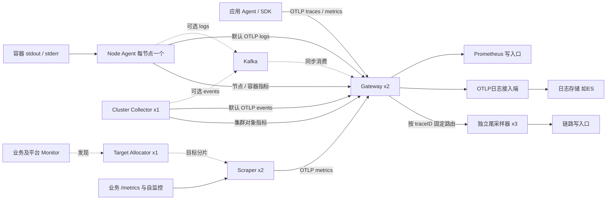
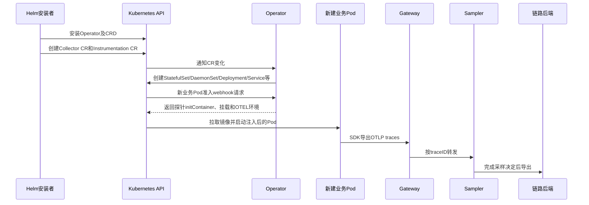

# OpenTelemetry 采集与处理架构（0.7.13）

本文描述交付包实际生成的资源、pipeline、配置接口和恢复边界。安装主线在 [部署文档](02-部署文档.md)；版本与验证范围见[版本验证](#版本验证)。源码、values和打包产物一同交付，不依赖生成脚本安装。

0.7.10 的实测发现长 UTF-8 日志损坏及 Gateway 扩容后既有流量未迁移。0.7.11 修正这两项配置，保留固定镜像与采样策略；见[当前验收状态](#当前验收状态)。

<a id="当前验收状态"></a>
### 当前交付与验收口径

0.7.13 的尾采样默认从首个 span 到达 Sampler 起等待 20 秒。

0.7.12 将两份 Collector 基础 YAML 合并为 `files/collectors.yaml`，Remote Write 只保留出口差异；重构前后 24 个协议/存储/日志传输/HPA 组合的完整资源渲染等价。新增 `collector_resources` 原生资源覆盖，旧 values 保持兼容；日志上限联动 filelog/container/recombine，诊断指标白名单可配置，默认仍关闭。当前版本的集群验证范围以本次测试结果为准，不继承历史容量结论。

0.7.9 增加完整云端地址、可选诊断指标和受控 HPA，保持这些能力默认关闭。0.7.10 精简安装入口并统一 Gateway 默认 4Gi，保持原安装主线预算。所有后端共用一份集群配置，可选项和验证范围集中在本文；不再维护场景模板和拆分说明。历史测试报告和证据不替代当前验收；0.7.13 的集群验收待执行，0.7.12 的历史结果见[固定版本与验证证据](#本次功能验证)，生产峰值和完整故障验收仍需另行验证。

已清理的历史报告不作为当前可复现证据，历史结果不能替代当前版本或长 UTF-8 日志完整性的验收。

**自0.7.7起默认不使用PVC。** Chart 默认 `persistent_queue: false` 统一控制所有 Collector；需要持久发送队列时在集群 values 添加 `persistent_queue: true` 和 `storage_class`。无PVC仍保留Node的hostPath日志读取位置，以及必要的emptyDir临时目录；不是“所有状态都不碰磁盘”。两种模式的丢失边界和存量切换见[存储开关](#内存队列)。


## 阅读导航

- 初学者先看[基本概念](#基本概念)、[总体架构](#总体架构)、[业务配置](#业务配置)与[连接和证书](#连接和证书)。
- 理解数据怎么走，看[三信号pipeline](#三信号原理)、[尾采样](#尾采样)、[指标发现](#指标发现)。
- 做生产容量、运维、变更，看[资源与恢复](#容量与恢复)、[安全边界](#安全边界)、[生产运维](#生产运维)、[故障演练](#故障演练)。
- 百度云/AWS适配看[云环境](#云环境)，参数与文件关系看[交付结构](#交付结构)。
- 实际安装按[部署文档](02-部署文档.md)，不需要先理解本文全部实现细节。

<a id="基本概念"></a>
## 0. 先分清三要素、采集层和后端

| 名词 | 在本方案中的含义 | 不代表什么 |
| --- | --- | --- |
| Trace / span | 一次调用链及其中的一段操作；通过traceID、spanID、parentSpanID关联 | 日志里出现ERROR不等于span状态ERROR；未埋点的操作不会自动出现 |
| Metrics | 一段时间内的计数、耗时分布、CPU、内存、对象状态等数值 | 不是每次请求都保存一份完整原始记录；业务指标需应用或exporter实际提供 |
| Logs | 应用stdout/stderr以及Kubernetes事件 | 不会默认读取应用任意文件或替应用生成日志 |
| OTLP | OTel传输协议，支持HTTP/protobuf及gRPC | 不是ES Bulk、Prometheus查询API或Prometheus文本`/metrics`协议 |
| Collector | 接收→处理→输出数据的进程 | 发送队列不是长期查询数据库；Collector本身不提供完整监控看板 |
| Operator | K8s控制器，根据CR创建Collector/TA并注入探针 | 不处在每条遥测数据的转发路径中 |
| Instrumentation CR | 注入用的探针镜像、endpoint、sampler和环境配置 | 只创建CR不会给已运行的应用Pod自动热加载探针 |
| PodMonitor / ServiceMonitor | 描述哪些Pod/Service的哪个端口提供Prometheus指标 | 不会给应用创造`/metrics`，也不是指标存储 |
| PVC / StorageClass | PVC申请持久存储，StorageClass决定由哪个CSI/哪类云盘供应 | PVC不是对象存储桶的同义词，也不自动决定队列的逻辑容量 |
| CA / ServiceAccount | CA验证HTTPS服务证书；ServiceAccount token用于向K8s/kubelet证明身份 | CA不是云账号密钥；有可信证书也不等于有RBAC权限 |

**采集平台安装好**和**业务接入成功**是两件事。平台Ready后，服务仍需探针/SDK实际产生trace和metrics、输出日志；后端仍需接收并保存。最终以三类数据可查为准。

本方案的通用边界在OTLP与Prometheus写接口。换成另一个兼容后端通常改endpoint、协议、认证/CA即可；换成不兼容协议、改变队列类型或拓扑时，属于接入适配/迁移，不能承诺只换URL。

<a id="总体架构"></a>
## 1. 总体架构与职责



每个集群独立部署、使用唯一稳定cluster_name。多个集群可共用后端，但查询与告警必须保留集群维度。

| 组件 | 默认形式/数量 | 职责及可用性边界 |
| --- | --- | --- |
| Operator | Deployment/1 | 管理CR、创建Collector/TA、新Pod注入。已有Collector不依赖它逐条转发；故障会影响注入、协调。不能安装多套管理相同资源的Operator |
| Gateway | StatefulSet/2 | 接入、元数据/脱敏、指标标签、日志出口、traceID路由；默认内存队列，开启持久化后用PVC |
| Sampler | StatefulSet/3 | ERROR/慢链路/概率尾采样；每个trace归属一个分片，各实例不是同一trace的副本 |
| Node | DaemonSet/每Linux节点一个 | 容器文件日志、hostmetrics、kubeletstats；checkpoint始终在独立hostPath，发送队列按开关选择内存/hostPath |
| Cluster | StatefulSet/1 | 集群对象状态与Events；单实例避免重复采集，有故障恢复窗口 |
| Scraper | StatefulSet/2 | 执行TA分配的Prometheus抓取；默认内存输出队列，开启持久化后用PVC；副本之间为分片关系 |
| TA | Deployment/1 | 发现Monitor/静态job、分配目标；短暂故障会影响发现与重分配，不是指标存储 |

本交付不安装存储、查询、看板或告警平台；不自动覆盖控制平面、数据库、中间件、自定义业务指标或服务图。`k8s_cluster`不是kube-state-metrics同名指标全集，hostmetrics也不保证兼容所有node-exporter看板。

这些组件和[Agent/Gateway模式](https://opentelemetry.io/docs/collector/deploy/gateway/)属于上游支持的部署方式。平台chart是本方案维护的封装，不是上游官方发行的一整套生产配置。filelog、tail_sampling等组件在固定上游版本仍标记Beta；生产使用必须锁版本并回归。


### 1.1 控制面、数据面和资源所有权



1. 官方Operator chart负责Operator、Webhook和OTel CRD；平台chart不是另一套Operator。
2. 平台chart负责各角色的Collector CR、两个Instrumentation CR、SA/RBAC、Secret、自监控Monitor、NetworkPolicy和Sampler headless Service，并归档Monitor CRD。
3. Operator把Collector CR协调成实际工作负载、配置和普通Service。Pod名称中带`-collector`；TA从Scraper CR生成。
4. 默认StatefulSet使用emptyDir临时目录，不创建PVC。启用持久化后依据volumeClaimTemplates创建每Pod独立PVC；Node始终挂自己的宿主状态目录。
5. 更新源values后用Helm更新CR。不要直接编辑Operator生成的Pod/StatefulSet/ConfigMap，它们可能被重新协调覆盖。
6. `upgradeStrategy: none`不等于禁止配置更新；它避免把Collector镜像升级交给Operator默认自动处理，镜像由固定values管理。

平台chart有固定资源名，如`otel-gateway`、`otel-node`和`standard`。同一namespace不要装第二个release企图复用这些名字；生产同一集群也不要无意部署两套Node/Cluster采集造成重复。复用已有Operator先核对CRD、版本、证书、管理范围及资源所有权。

默认Webhook `failurePolicy: Ignore`：Webhook故障时业务Pod可能继续创建但**没有探针**。已有Collector可继续运行，新Pod注入及配置协调受影响。以实际initContainer、环境和数据判断注入成功。

<a id="连接和证书"></a>
### 1.2 连接关系、端口和三类CA

以下都是调用方向。具体云安全组、网格或NetworkPolicy要按该方向放行；本chart不管理云网络资源。

| 发起方 | 目标 | 用途/默认端口 | 信任与认证 |
| --- | --- | --- | --- |
| 业务SDK | `otel-gateway-collector.observability.svc` | OTLP HTTP4318或gRPC4317 | 当前可信内网明文，不配置业务入站认证 |
| Node/Cluster/Scraper | Gateway普通Service | OTLP gRPC4317 | 内部明文，日志始终由 Gateway 处理 |
| Gateway | Sampler固定ordinal DNS | OTLP gRPC4317 | 固定traceID路由，内部明文 |
| Sampler | trace_endpoint | 采样后traces；端口由后端决定 | TLS验证与TRACES_AUTHORIZATION |
| Gateway/独立logs | log_endpoint | OTLP logs | TLS验证与LOGS_AUTHORIZATION |
| Gateway | metrics_endpoint | OTLP或Remote Write | TLS验证与METRICS_AUTHORIZATION；AMP可用SigV4 |
| Node | 自己的节点地址 | kubelet HTTPS10250，采容器指标 | kubelet CA/SAN + SA token + nodes/stats权限 |
| 各需元数据角色/TA | Kubernetes API | HTTPS，端口按集群Service | Pod内SA CA、token和RBAC |
| Scraper | TA | 默认Service80，读取目标分配 | 默认集群内HTTP；认证Monitor场景另启用TA mTLS |
| Scraper | 被抓取目标 | 应用命名metrics端口、Collector8888、TA8080等 | 依Monitor/job定义，不自动开放应用端口 |
| Scraper | Operator Service | 自监控HTTPS8443 | Operator公开CA、TLS server_name、SA bearer token |
| Kubernetes控制面 | Operator Webhook Service | Pod准入/CR webhook HTTPS，按实际Service与targetPort | Webhook CA bundle、服务证书，需控制面可达 |
| Pod | DNS/镜像仓库 | 服务解析、拉取应用/探针镜像 | DNS网络、仓库凭据和镜像架构需实际可用 |

本文固定示例平台namespace为observability；真实模板的Service DNS随release namespace生成。默认不暴露公网Ingress/LoadBalancer业务入口。

三种证书用途分开：

- `backend_ca_file`：校验三类后端的服务器证书；空值使用系统信任库，私有根放trust Secret。
- `kubelet_ca_file`：校验节点kubelet服务器证书，默认Pod内ServiceAccount CA；实际签发CA或SAN不同须调整。K8s API的CA可信不必然意味着同一CA签发所有kubelet证书。
- `operator_metrics` CA：Scraper安全抓取Operator的自监控。默认安装时从Operator Secret读取公开`ca.crt`并复制到平台trust Secret；不需要提取私钥。离线渲染无lookup结果时显式提供CA。

`x509`涉及证书链、地址/SAN、有效期和CA；401/403涉及身份/权限；超时还需查DNS、路由和策略。不要把所有问题都用关闭TLS验证处理。`trace_headers/log_headers/metrics_headers`加在**平台到后端**的请求上，不能当作应用到Gateway的入站认证。

### 1.3 多副本、调度与可用性

默认Gateway/Scraper各2副本、Sampler 3副本，采用按节点hostname的拓扑分布约束；实际跨节点/可用区落点还取决于可调度节点、污点、资源和云盘拓扑。副本数量本身不保证跨可用区容灾。

- Gateway是多入口，Service可分配请求到任一实例；各自队列独立，没有自动队列复制。
- Sampler是按traceID分片，不是同一trace的双份副本；同一trace在单个Sampler组装。Pod换IP通过固定ordinal DNS恢复，不自动改路由环。
- Scraper是按目标分片，TA帮助避免两个实例对同一目标持续重复抓取；重分配期间的间隙/重叠与后端乱序仍需监控。
- Cluster和TA默认单实例。Cluster避免重复对象/事件采集；TA故障会影响目标发现和再分配。已有分配/抓取的实际持续行为依赖缓存、重试和故障时长，不能承诺无限期不受影响。
- Gateway/Sampler/Scraper默认PDB允许最多1个不可用；Cluster单副本minAvailable=0。Operator自带PDB默认关闭。PDB主要约束自愿驱逐，不能防止节点宕机、OOM或强制删除，也不保存尾采样内存。

外层路由队列默认单消费者，存储方式由persistent_queue决定。目标Sampler故障后重试会占用发送工作，健康分片也可能受背压影响；有磁盘队列意味着有界缓冲，不意味着所有分片不中断。恢复/扩缩采样器要按固定环、队列与待决窗口一起规划。

<a id="三信号原理"></a>
## 2. 数据链路与全部 pipeline

以下是默认 direct + OTLP HTTP的实际顺序。`resource/extra`仅在配置resource_attributes时插在resource/node或resource/cluster之后。

| 角色/信号 | receiver → processors → exporter |
| --- | --- |
| Gateway traces | otlp → memory_limiter → k8s_attributes → resource/cluster → 可选filter/trace_noise → transform/trace_resource → attributes/redact → load_balancing/traces |
| Sampler traces | otlp → memory_limiter → resource/cluster → tail_sampling → otlp_http/traces（默认内存队列） |
| Node logs | filelog → memory_limiter → k8s_attributes → filter/log_opt_in → resource/node → transform/log_json → otlp/logs（默认内存队列） |
| Gateway logs | otlp → memory_limiter → resource/cluster → otlp_http/logs（默认内存队列） |
| Node metrics | hostmetrics + kubeletstats → memory_limiter → resource/node → otlp/metrics（默认内存队列） |
| Cluster metrics | k8s_cluster → memory_limiter → resource/cluster → otlp/metrics（默认内存队列） |
| Cluster events | k8s_events → memory_limiter → resource/cluster → otlp/logs（默认内存队列） |
| Scraper metrics | prometheus（TA分片）→ memory_limiter → resource/cluster → otlp/metrics（默认内存队列） |
| Gateway metrics | otlp → memory_limiter → k8s_attributes → resource/cluster → transform/metric_labels → filter/empty_metrics → otlp_http/metrics（默认内存队列）或prometheus_remote_write（专用WAL） |

`persistent_queue: true`会把适用出口的发送队列改为持久存储，不改变上述处理顺序。Remote Write使用自己的WAL，存储目录随开关使用PVC或emptyDir，见[存储开关](#内存队列)。

Collector内部组件名带后缀只用于区分实例。当前采用的`otlp`是固定版本支持的兼容名称；上游会提示其gRPC exporter别名弃用，不代表该版本配置不可运行。后续升级应根据新版本迁移并重跑测试。

### 2.1 Kafka模式

**默认关闭**，`logs_transport: direct` 保持日志直发。用户选择开启后，可接 Kubernetes 内自建 Kafka，也可接云服务或已有 Kafka；两者复用同一组 brokers、Topic/Group、TLS/SASL 参数。自建 Kafka 的生命周期和 PVC 独立于采集平台，不受 Collector 的 `persistent_queue` 开关控制。统一配置与切换步骤见[Kafka 接入](#Kafka接入)。

`logs_transport: kafka`只改变日志/事件中间传输：

- Node logs和Cluster events输出Kafka，先进入各自发送队列；是否持久化由persistent_queue决定。
- 日志Gateway从Kafka读OTLP protobuf，而非原始文本。
- Kafka receiver：initial_offset=earliest、提交间隔1s、after=true、on_error=false、on_permanent_error=false；失败不提前确认。
- 日志后端exporter禁用异步发送队列；没有在Kafka确认之前插入batch processor。后端成功才允许调用返回成功。
- Kafka生产acks=all、zstd、禁止自动建topic；接入账号、分区、ACL、消息上限及retention由Kafka管理员配置。
- `kafka_metrics.enabled`只允许在Kafka传输模式启用，额外查询需要权限。

重试、提交和崩溃可产生重复；部分成功或永久坏消息仍需处置。设计目标是有限容量内的可恢复传输，不承诺exactly-once。ES Bulk部分失败也要检查单文档结果，不能只以HTTP200认定全部成功。

<a id="Gateway日志链路"></a>
### 2.2 Gateway 统一处理日志

Gateway 共用实例处理日志、指标和 Trace 入口；尾采样始终独立。日志直发时，Node/Cluster 通过 OTLP 发送到 Gateway；开启 Kafka 时，Node/Cluster 写 Kafka，再由 Gateway 消费并同步写日志后端。两种模式使用同一组 Gateway，不创建独立日志组件。

默认不创建 Collector PVC；开启持久队列后，按默认副本创建 8 个 PVC：Gateway2 + Sampler3 + Scraper2 + Cluster1。Node hostPath 另计。Kafka 不隔离 Gateway 内各信号的 CPU、GC 和网络争用，容量按总流量核算。

<a id="尾采样"></a>
## 3. 尾采样的准确语义

Java/Python/Node.js和SDK环境注入均使用always_on；应用侧头采样丢弃的span无法由尾采样补回。手工SDK、代码内sampler、环境覆盖、已有APM和外部上游仍须逐项检查。

Gateway完成Kubernetes关联与脱敏，再用load_balancing的traceID固定哈希路由。同一trace经不同Gateway仍须到同一Sampler。固定端点是：

```text
otel-sampler-collector-0.otel-sampler-headless.<namespace>.svc:4317
otel-sampler-collector-1.otel-sampler-headless.<namespace>.svc:4317
otel-sampler-collector-2.otel-sampler-headless.<namespace>.svc:4317
```

所有Gateway必须使用同一端点集合。显式headless Service与Sampler的serviceName对应；publishNotReadyAddresses仅保证启动期DNS可见，不代表未Ready可成功接收。普通Service不能替代按ordinal的路由。Pod换IP不改变固定哈希端点，故障时该分片会积压；不自动切到另一个Sampler，否则正在组装的trace可能被拆开。

### 3.1 默认策略

策略取OR：任意span status.code=ERROR、完整已收到trace的最早开始到最晚结束至少2000ms、或约1%概率命中，即保留。

```yaml
tail_sampling:
  decision_wait: 20s
  num_traces: 200000          # 2026-10-24 压测后由 10000 上调；容量公式见 6.2
  expected_new_traces_per_sec: 0
  maximum_trace_size_bytes: 5242880
  decision_cache:
    sampled_cache_size: 300000
    non_sampled_cache_size: 300000
  policies:
    - name: errors
      type: status_code
      status_code: {status_codes: [ERROR]}
    - name: slow
      type: latency
      latency: {threshold_ms: 1999}
    - name: baseline
      type: probabilistic
      probabilistic: {sampling_percentage: 1}
```

**为什么是1999：固定上游版本latency按整数毫秒计算并使用严格`>`，所以1999实现至少2000ms。** 已用1999/2000/2001ms运行边界验证。不要误改成2000后仍声称包含恰好2秒。

ERROR是span状态，不是任意包含“error”的文本。SDK未把HTTP500标成ERROR时，需修正埋点或按真实语义增加策略。普通1%不是每一百条固定保留一条。

20s从首个收到的span开始，不是请求结束后再等20s，也不是后端数据保存时长。业务要求请求不超过5秒，不代表所有span都能在5秒内到达Sampler；窗口还须覆盖SDK批量导出、网络和排队延迟。晚到的错误span可能继承已缓存的丢弃决定，不能依靠decision cache补救全部晚到错误。长异步任务或超过窗口的链路须单独验证。缩短窗口可减少待决缓存和采样等待，不会提高出口的稳态发送能力。

正常运行仅在20秒窗内收齐判断所需span、单trace未超过5MiB、未超容量且入口/出口可用的范围内保证符合策略的数据保留；超窗错误不承诺补回。SDK头采样或未产生的span也不在保证范围内。

### 3.2 内存和故障边界

- 待决trace与决策cache默认在内存，不受exporter磁盘队列保护。Collector异常退出、OOM或节点故障可能丢失；必须由项目负责人按RPO确认并演练，本文不默认接受该损失。固定版本正常关闭默认按已收到的部分数据执行决策，因此滚更不等于必然丢失，也不保证迟到span完整。
- num_traces限制条数，不是字节。单trace超过5MiB会被丢弃以保护内存；监控超限、提前淘汰和决策耗时。
- 初始Sampler三副本、每个4Gi上限，不是200服务容量承诺。按全量新trace/s×等待窗口×余量核算条数，再按真实span大小/数量测RSS。
- 路由外层队列保存未送达请求；默认在内存，启用持久化后保存在磁盘；内层OTLP禁用异步队列、有界调用、外层负责重试。故障端点仍可能占用重试worker并造成背压，不能称无损自动故障切换。
- 只有启用持久化、成功入队并保留原存储的数据，才可按持久卷恢复。待决状态、SDK尚未导出的内存数据、永久坏记录不在此保证范围。
- 不配置Sampler HPA。副本变化改变哈希环，须按维护流程控制新流量、排空路由队列并考虑等待窗口；无法承诺变更期间每条trace完整。

详见[固定版本tail_sampling](https://github.com/open-telemetry/opentelemetry-collector-contrib/blob/v0.163.0/processor/tailsamplingprocessor/README.md)和[load_balancing](https://github.com/open-telemetry/opentelemetry-collector-contrib/blob/v0.163.0/exporter/loadbalancingexporter/README.md)。

<a id="业务配置"></a>
## 4. 业务接入与日志处理

### 4.1 注入、选择和资源身份

原生annotation值使用`observability/standard`；已有/metrics使用`observability/standard-prometheus`。后者关闭SDK metrics，不关闭trace。两者SDK logs都关闭，避免与stdout重复。

同语言namespace可设置原生注入annotation，但只影响新Pod；混合语言优先逐Deployment灰度。停止注入时Pod模板明确设对应annotation为`"false"`再滚动，仅删除可能仍继承namespace默认值。只采日志使用Pod或namespace label `observability.example.com/enabled: "true"`；Pod同名label为`"false"`优先停采日志。

有效Java/Python/Node.js/SDK注入annotation也会选中该Pod日志。opt-in决定导出，不是宿主文件访问隔离：未选中文件仍可能先被读取解析。平台namespace默认排除；`log_namespaces`非空时只读取这些namespace路径，主要用于受控范围采集和隔离测试。

建议所有服务固定`app.kubernetes.io/name`与version；不要把Pod名作为逻辑服务名。集群/环境来自values，实例、Pod UID等由SDK或采集器保留。上游支持的库能自动产生span；自定义协议、异步传播、自定义业务指标仍需埋点。

<a id="Java启动保护"></a>
Java 注入后应在目标资源和真实启动依赖下测量应用容器启动耗时，并为业务容器配置 `startupProbe`。使用应用已有且能反映启动完成的健康检查，按实测最慢启动时间加余量设置 `failureThreshold × periodSeconds` 的启动预算；不要把包含调度、镜像拉取及 initContainer 的 Pod 总耗时直接当作应用启动时间，也不要统一套用某次测试的 58 秒或 120 秒。startupProbe 成功前，Kubernetes 不执行该容器的 liveness/readiness 探测；成功后由原有探测接管。保留 readiness 的流量准入检查和 liveness 的运行期故障检查，不用无限放宽 liveness 延迟代替启动保护。灰度后核对启动成功、Ready 和重启次数。[Kubernetes 启动探测说明](https://kubernetes.io/docs/tasks/configure-pod-container/configure-liveness-readiness-startup-probes/#protect-slow-starting-containers-with-startup-probes)

### 4.2 filelog和应用多行堆栈

receiver内部顺序为container parser → 文件+stdout/stderr分源 → 按来源可选recombine → 删除临时源字段，之后才进入processors。

- container parser识别CRI/Docker外层时间/流/路径，恢复CRI P/F分片；这与应用堆栈合并不是一件事。
- 单行JSON内转义换行本来是一条事件，无需额外recombine。
- 多行文本默认不合并。先确认真实首行格式，再按namespace/container等路径信息开启，避免把独立日志错误拼接。

例如orders-prod的app容器使用日期首行，在集群values追加：

```yaml
log_processing:
  filelog:
    recombine:
      if: 'resource["k8s.namespace.name"] == "orders-prod" and resource["k8s.container.name"] == "app" and not (body matches "^[[:space:]]*[{]")'
      is_first_entry: 'body matches "^[[]?[0-9]{4}[-/][0-9]{2}[-/][0-9]{2}[ T]"'
```

该阶段只能使用路径解析的namespace/Pod/container，不能使用稍后API补充的Deployment label。原始Python traceback、Go panic等不能直接套日期规则。

默认128源、128行、262144字节触发刷新、1s强制刷新。达到阈值会拆分；按文件和输出流隔离。缓存早于memory_limiter且未写WAL，进程崩溃可能丢未刷片段。增加源数/上限要重新预算Node内存。

filelog保持64文件并发、`max_batches: 0`，分批遍历全部匹配文件，不能用单批限制替代并发限制。filelog默认beginning，已有checkpoint优先。新容器启动日志可以保留，首次安装也会读取仍在磁盘的历史文件，须预算接入突增。轮转删除、Pod元数据过期和节点永久丢失会限制补采。

<a id="日志轮转"></a>

**轮转文件覆盖（0.7.8起）：** Node同时匹配活动文件`*.log`与未压缩轮转文件`*.log.*`，重新发现改名后尚未读完的尾部；排除`*.gz`和压缩过程的`*.tmp`。固定container parser支持`0.log.YYYYMMDD-HHMMSS`路径，压缩/临时文件不交给它解析。

默认全集群范围继续排除平台namespace，排除规则同时覆盖其活动及轮转文件。显式设置`log_namespaces`时，仅在指定namespace生成两类匹配；显式包含平台namespace时允许该范围，日志仍受原有opt-in处理器控制。该分支保留gzip/tmp排除，不能再把exclude整个清掉。路径由Chart生成，不是需要追加到根values的参数。

初装的`beginning`会读取仍存在的匹配历史文件。存量从窄匹配升级后，新发现的轮转文件可能没有保留checkpoint，即使沿用原状态目录，也可能补读已发送的历史日志并产生重复。不要删除状态目录来规避；维护及回滚边界见[日志轮转升级](02-部署文档.md#日志轮转升级)。离线跨过多次轮转/压缩、日志删除和节点丢失仍可能无法补齐，本配置不承诺exactly-once。

### 4.3 日志时间、级别、ID与脱敏

推荐应用输出：

```json
{"timestamp":"2026-10-22T12:00:00.123+08:00","level":"ERROR","message":"inventory timeout","trace_id":"0123456789abcdef0123456789abcdef","span_id":"0123456789abcdef"}
```

处理器支持JSON常见trace_id/traceId/otelTraceID/trace.id及span对应别名和嵌套trace.id/span.id；支持命名明文字段、完整`[trace,span]`对及traceparent。只提升合法非零32/16位hex到原生字段，不凭空生成关联ID。

支持字符串level/levelname、Pino数字级别10/20/30/40/50/60，以及明确日期首行文本级别。JSON timestamp/@timestamp/time支持带时区RFC3339字符串；未知格式保留容器时间。无时区文本按真实layout/timezone显式启用application_time，例如Asia/Shanghai。数字epoch或任意自定义格式须另定规则。

Java MDC、Python handler/formatter、Node logger和Go context logger须实际输出ID。采样丢弃trace后，日志中仍可能有合法ID而查不到对应trace。

日志归一化保留结构化body，只删除列出的顶层password/authorization/cookie。trace删除列出的Authorization/Cookie、db.statement/db.query.text、url.full/url.query/url.fragment、旧版http.url/http.target及http.request.body/http.response.body属性；保留独立url.path、http.route、server.address等定位字段。删除完整URL可能减少旧埋点的定位信息，业务应提供安全的路由/路径字段。此规则不扫描URL路径中的个人信息、span事件、任意嵌套JSON或自由文本；按实际业务字段补充脱敏，应用侧避免输出秘密。


### 4.4 annotation、label与三要素的准确关系

| 配置 | Trace | SDK metrics | 容器stdout/stderr日志 |
| --- | --- | --- | --- |
| 有效Java/Python/Node.js注入 + standard | 支持的库/框架自动埋点 | SDK及支持库实际产生的指标 | 被Node opt-in选中 |
| 同上 + standard-prometheus | 保留 | 关闭注入SDK的metrics；另配/metrics抓取 | 被选中 |
| inject-sdk（如Go） | 只有应用初始化SDK及埋点后才有 | 只有实际初始化/记录后才有 | 有效注入标记可被选中 |
| 仅observability.example.com/enabled=true | 不生成 | 不生成 | 被选中 |
| 仅app.kubernetes.io/name | 不生成 | 不生成 | 只提供服务身份，不单独启用采集 |

annotation放在Deployment的`spec.template.metadata.annotations`；普通label在`spec.template.metadata.labels`。修改模板会随正常发布创建新Pod。只给顶层Deployment metadata加注解，不会注入其Pod。

自动埋点覆盖的是上游支持的库与框架，不覆盖任意业务函数。跨服务要传播W3C tracecontext；业务自建HTTP客户端、MQ/异步、线程切换和非标准协议须检查传播。Go不启用eBPF，inject-sdk主要提供endpoint/resource/sampler等环境，代码必须使用这些设置初始化对应SDK。

注入配置默认OTLP HTTP/protobuf，应用发往Gateway4318。`standard`打开SDK metrics；`standard-prometheus`将注入的metrics exporter设none；两者日志exporter均none，由Node读stdout避免双份。默认SDK metrics累计temporality、周期60s、BSP queue2048、export batch128、属性值长度4096。这些是有界内存设置，不是应用退出时的磁盘保护；应用应按语言SDK正确结束/flush，探针额外内存需纳入业务Pod预算。

生产logger的MDC/formatter仍需配置。能在后端找到日志，与能点击日志跳转trace是两次验收：前者验证采集，后者需要合法ID被解析成原生字段且对应trace被保留。尾采样丢弃的trace仍可能留下带ID日志，这是正常边界。

部署文档提供 Java、Python、Node.js 服务的注入及验收步骤；[独立Java验证](#独立Java验证)提供完整Deployment、接口调用和查询命令，使用公司批准的Java17/21镜像验收实际业务及跨服务传播。其他语言与框架使用实际业务服务单独验证，不能据此宣称任意框架零代码可用。

### 4.5 Java 17/21 + Spring Boot 3：三条独立数据路径

1. **Trace**：Operator为新Pod加入initContainer，复制Java agent并向`JAVA_TOOL_OPTIONS`追加`-javaagent`。探针为支持的Servlet/Spring MVC、HTTP client、JDBC等库埋点，通过OTLP HTTP发往Gateway；Gateway按traceID固定路由到Sampler，Sampler决策后发往trace后端。无需在业务代码初始化第二个SDK。跨服务正确性要核对同一traceID、parentSpanId和ERROR/慢请求，而非只看有几个span。
2. **Logs**：探针提供MDC上下文，Logback实际把ID写进stdout，Node按CRI读取并解析；JSON字段或文本ID被提升为原生trace/span字段，经日志处理、发送队列发往日志后端；默认内存，开启持久化后落盘。Java logs exporter保持none，避免与filelog重复。推荐单行JSON；文本异常堆栈必须针对实际Pod配置首行规则，多行合并发生在元数据API补充之前。服务启动日志没有活动span时，ID为空属于正常现象。
3. **Metrics**：探针产生受支持的JVM/HTTP等指标，应用业务Counter由代码使用OTel API记录；SDK累计值按周期送Gateway，再转为公司后端选择的OTLP或remote_write。自定义业务Counter不能靠annotation推导。是否把`service.name`等resource提升为Prometheus标签，由后端接收配置决定；查询时要核对实际标签和单位，不能把resource与数据点属性混为一谈。

已验证的应用固定Spring Boot 3.5.16，使用Java 17字节码，在JRE 17/21上运行。本地kind历史验证使用Java17 Logstash JSON及Java21文本多行堆栈；本次new-dev验证两套Java均输出Boot原生Logstash JSON（含单行`stack_trace`）。日志形态由Deployment环境变量控制，两种验证范围在[版本验证](#版本验证)区分。H2验证自动JDBC span，自定义Counter使用固定`test_case`标签，唯一请求标记只出现在span/日志中，避免指标高基数。

历史本地kind验证用debug和file exporter逐字段断言，并查询临时Prometheus；new-dev本轮则写入真实Prometheus、Elasticsearch和Tempo后查询验收。两者均未把生产默认出口改为debug。debug不能代替后端落库，也不用于生产高流量数据出口。

跨线程、`@Async`、自建Executor、WebFlux/Reactor、Kafka/RabbitMQ、Redis/MySQL、其他数据库驱动以及真实公司Boot小版本，需要用真实服务单独回归。SDK/agent兼容、业务日志格式正确、后端协议/认证正确，是三项独立条件。

<a id="服务身份审计"></a>
### 4.6 服务身份核对

固定逻辑服务名，优先在业务容器显式设置 `OTEL_SERVICE_NAME`，并与 Pod 模板的 `app.kubernetes.io/name` 保持一致；当前日志处理也有 Deployment 名回退，缺少应用标签不等于所有日志服务名必为空。不用正则删除疑似 hash 后缀来猜测服务名。

先保存业务 Pod 快照，用于与后端真实数据核对。快照可能含业务环境变量，应限制文件权限且不提交：

```bash
OTEL_AUDIT_NS='替换为业务namespace'
(umask 077; kubectl --context "$OTEL_CONTEXT" -n "$OTEL_AUDIT_NS" get pods -o json > pods.local.json)
```

在实际使用的日志、Trace、Metrics 后端分别查询该服务的数据，人工核对以下内容，并记录查询时间、条件和脱敏样本：

| 核对项 | 要求 |
| --- | --- |
| 服务名 | 后端的 `service.name`/`service_name` 与预期逻辑服务名一致，不使用随发布变化的 Pod/ReplicaSet 名 |
| 实例身份 | namespace、Pod 名与快照一致；有 Pod UID 时同时核对 UID，多容器时核对容器名 |
| 信号范围 | 逐一核对本次启用的信号；仅日志或仅指标接入不要求不存在的信号 |
| 动态配置 | `valueFrom`、`envFrom` 或应用代码生成的身份须核对实际运行值，不能仅凭 YAML 推断 |

后端属性或标签必须来自实际查询，不能用应用配置反填。缺少所需信号的数据时，结论为待验证；只有 Pod 快照不能证明后端身份正确。某个后端没有 UID 字段时，只能确认 namespace/Pod 名对应，不能据此声称已核对 UID。

<a id="指标发现"></a>
## 5. 指标来源、发现与重复采集

| 来源 | 默认周期 | 边界 |
| --- | --- | --- |
| SDK | 60s cumulative | JVM/进程/支持库指标因语言不同；自定义业务Counter/Histogram要埋点 |
| hostmetrics | 30s | CPU、内存、load、磁盘、网络、文件系统；排除伪文件系统和容器挂载路径 |
| kubeletstats | 30s | pod/container/volume；CA/SAN、10250网络和nodes/stats权限必须正确 |
| k8s_cluster | 30s | Deployment等对象状态、request/limit、节点条件/allocatable；不是控制平面全部指标 |
| Prometheus抓取 | Monitor/job决定 | 端口/path/selector/认证正确，TA分片避免多个Scraper重复采同一目标 |
| 自监控 | 30s | Collector/TA经Monitor；Operator经HTTPS、公开CA/SAN及SA token安全抓取 |

现有node-exporter/kube-state-metrics/云监控可复用；决定每类指标的唯一采集路径，不为统一OTel而重复采集。同一业务指标族选SDK或/metrics；注入standard-prometheus只关闭注入SDK的metrics，代码内初始化仍需确认。

PodMonitor例：

```yaml
businessPodMonitors:
  - name: inventory-api
    namespace: business-prod
    spec:
      selector:
        matchLabels:
          app.kubernetes.io/name: inventory-api
      sampleLimit: 20000
      targetLimit: 200
      labelLimit: 64
      podMetricsEndpoints:
        - port: metrics
          path: /metrics
          interval: 30s
          scrapeTimeout: 10s
```

业务须真正暴露命名metrics端口。`businessPodMonitors` 的每个业务 namespace 必须在安装或升级平台前存在，因为 Helm 会在该 namespace 创建 PodMonitor；`--create-namespace` 只创建 release 的平台 namespace。尚未创建业务 namespace 时，先保持 `businessPodMonitors: []`，待 namespace 和业务就绪后再通过同一份集群 values 执行 Helm upgrade 补上。chart添加owner=otel并合并基础身份relabel。已有Monitor加owner label可复用；monitor_namespace_selector同时限制四类Monitor发现范围。sampleLimit超限会使该次抓取失败，不是只截取前20000条。

现有Prometheus若全选Monitor，新增Monitor也会被它发现。先协调发现范围和写入目标，防止重复；本平台不能替其他系统排除测试/业务Monitor。

`monitor_resources_enabled: false`不创建平台/业务Monitor，并关闭TA的prometheusCR发现；`scrape_jobs`可传入原生Prometheus scrape_configs，由TA唯一分配。new-dev隔离测试采用此模式。关闭Monitor时不允许同时填写businessPodMonitors。

<a id="Service注解指标接入"></a>
### Service annotation 自动发现

各业务的指标端口、路径不同时，把以下配置合并进原集群 values，填写业务 namespace 白名单，再按部署文档升级平台。默认关闭；保留现有 `scrape_jobs` 与 Monitor。它是一份由 TA 分配的原生 Prometheus job，不需要额外 ServiceMonitor/PodMonitor。

```yaml
service_annotation_discovery:
  enabled: true
  namespaces: [business-a, business-b]
```

业务 Service 示例（合并到原 Service，selector 按实际填写）：

```yaml
apiVersion: v1
kind: Service
metadata:
  name: orders
  namespace: business-a
  annotations:
    prometheus.io/scrape: "true"
    prometheus.io/port: "8080"
    prometheus.io/path: "/actuator/prometheus"
    prometheus.io/scheme: "http"
spec:
  selector:
    app: orders
  ports:
    - name: metrics
      port: 80
      targetPort: 8080
```

`prometheus.io/port` 必填，表示 **Pod 实际监听端口**，不是 Service 的 `port`。该端口无需出现在 Service 的 `ports`/`targetPort` 中；Service 只需能通过 selector 发现业务 Pod。无需统一不同服务的端口名、端口号或路径。annotation 值必须为字符串；Helm 模板中使用 `prometheus.io/scrape: "{{ .metricsEnabled }}"`。

TA 通过 EndpointSlice 发现各 Ready、Running Pod，按 annotation 重写抓取端口；Scraper 每 30 秒分别访问 `scheme://Pod-IP:port/path`，超时 10 秒。多端口 Service 产生的候选目标会重写为相同的 Pod 指标地址；当前 TA 0.161.0 按重写后的目标计算哈希并忽略 `__meta_*` 标签，因此会合并这些候选项，每个 Pod 指标端点只分配一次。IPv4/IPv6 主机部分直接保留。未标注 `scrape: "true"`、未填写端口或端口超出 1–65535 的服务不采集。path/scheme 未填时默认为 `/metrics`/`http`；非法协议或非绝对路径不采集，path 不支持内嵌查询参数。

此白名单选择 **业务 Service 所在 namespace**，与 `monitor_namespace_selector` 无关；关闭 `monitor_resources_enabled` 也不会关闭此 job。指标携带 `k8s_namespace_name`、`k8s_pod_name`、`k8s_service_name`；`service_name` 优先取 Pod 的 `app.kubernetes.io/name`，未填时取 Service 名。去重依赖当前 TA 的目标哈希行为，升级 TA 后须重新验收多端口场景。[TA 0.161.0 目标哈希源码](https://github.com/open-telemetry/opentelemetry-operator/blob/v0.161.0/cmd/otel-allocator/internal/target/target.go)

现有 NetworkPolicy/应用侧策略须允许 Scraper 访问指标端口。HTTPS 使用正常证书校验；私有 CA、客户端认证等场景继续使用配置了认证的 Monitor/自定义 job，本开关不绕过 TLS 校验。

同一 Pod 指标端点只选择一种发现方式；避免多个已注解 Service 或已有 Monitor/`scrape_jobs` 重复覆盖它。应用须已暴露 Prometheus 格式指标；annotation 不会给应用创建接口。接入后按 [TA 功能验收](#TA功能验收)检查 `service-annotations` job 的实际分配和后端指标；不能只看 job 出现或 Pod Ready。

<a id="共享指标接入"></a>
同一抓取协议、端口名、路径和认证要求的业务可复用一个 PodMonitor。把以下条目合并到原集群 values 的 `businessPodMonitors`，替换平台 namespace 与 `spec.namespaceSelector.matchNames` 的业务白名单；Helm 会替换数组，不要意外删掉原列表：

```yaml
businessPodMonitors:
  - name: otel-business-shared
    namespace: observability
    spec:
      namespaceSelector:
        matchNames: [business-a, business-b]
      selector:
        matchLabels:
          observability.example.com/scrape: "true"
      sampleLimit: 20000
      targetLimit: 200
      labelLimit: 64
      podMetricsEndpoints:
        - port: metrics
          path: /metrics
          interval: 30s
          scrapeTimeout: 10s
```

共享 Monitor 位于平台 namespace，业务 namespace 不再各建一份 Monitor。在已允许范围内新增服务只需在 Pod 模板补以下标签，并真实暴露命名 `metrics` 端口；不同服务该命名端口对应的端口号可以不同：

```yaml
spec:
  template:
    metadata:
      labels:
        app.kubernetes.io/name: orders-api
        observability.example.com/scrape: "true"
    spec:
      containers:
        - name: app
          ports:
            - name: metrics
              containerPort: 8080
```

此片段须合并进业务原部署，端口按实际修改；标签不自动创建 `/metrics` 或开启 Trace 注入。已有 `/metrics` 并选定此路径时，注入 `standard-prometheus` 关闭 SDK metrics；同一目标不要再被其他业务 PodMonitor/ServiceMonitor 重复选中。端口名、路径、间隔或认证不同的业务另分组；需要由各 Service annotation 指定端口与路径时，使用前述 Service annotation 自动发现。

TA 的 `monitor_namespace_selector` 继续选择 **Monitor 对象所在 namespace**，须包含平台 namespace；PodMonitor 的 `spec.namespaceSelector` 选择 **目标 Pod 所在 namespace**，只支持 `matchNames`/`any`，`{}` 表示 Monitor 自身 namespace，不能直接填 TA 的 LabelSelector。当前接口无需改名或新增模式。新增业务 namespace 时更新目标白名单，并按实际限制核对日志和 OTLP 范围。namespace 收窄后按[TA 功能验收](#TA功能验收)同时核对自监控和业务目标。`sampleLimit` 是单目标单次抓取的样本限制，`targetLimit` 是对应抓取配置的目标限制；二者不限制历史时间序列总量。[NamespaceSelector 定义](https://prometheus-operator.dev/docs/api-reference/api/#namespaceselector)

### 5.1 认证Monitor

Secret权限不等于凭据能安全交付。使用basicAuth/authorization/OAuth/bearerTokenSecret的Monitor，需要TA mTLS；本包可透传上游target_allocator_mtls，证书由公司PKI或已有cert-manager提供。

```yaml
target_allocator_mtls:
  enabled: true
  useCertManager: false
  tls:
    certificateAuthorityCertificate:
      configMap: {name: otel-ta-ca}
    serverCertificate:
      certificateSecret: {name: otel-ta-server}
      keySecret: {name: otel-ta-server}
    clientCertificate:
      certificateSecret: {name: otel-ta-client}
      keySecret: {name: otel-ta-client}
target_allocator_secret_namespaces: [business-prod]
```

证书SAN需覆盖TA Service DNS，客户端具备clientAuth；Secret key默认tls.crt/tls.key，CA key为ca.crt。其他namespace只按显式列表授权；不为消除报错授予全局Secret读取。TA证书subPath挂载，轮换要重启相应工作负载。具体要求以[固定版本TA说明](https://github.com/open-telemetry/opentelemetry-operator/blob/v0.161.0/docs/target-allocator/README.md)为准。

### 5.2 指标标签和写入顺序

Gateway在所有metrics出口之前用`filter/empty_metrics`清理没有数据点的Metric及空scope/resource。固定版本通过恒为false的数据点过滤条件保留所有实际点，并触发空容器清理；合法零值、count=0的直方图和数据点flags不会按空指标删除。没有类型的Metric也会清除。Gateway的OTLP metrics发送队列关闭字节拆批：固定版本的队列拆批会在过滤之后重新生成空Metric。保留所选存储模式下的发送队列、字节容量和背压；HTTP/gRPC同样处理。入口仍限制4MiB，补充标签后输出可能更大；目标云服务的请求上限仍需验收。此处理不改变HTTP失败/部分成功的重试语义。


Gateway按白名单把Resource属性复制到指标数据点，已有同名点标签不覆盖：

| 维度 | 数据点标签 |
| --- | --- |
| 集群/环境 | k8s_cluster_name、deployment_environment_name |
| namespace/Pod/节点 | k8s_namespace_name、k8s_pod_name、k8s_node_name |
| 服务 | service_name、service_namespace |
| 容器/卷 | k8s_container_name、k8s_volume_name |
| 工作负载 | k8s_daemonset_name、k8s_statefulset_name、k8s_replicaset_name、k8s_job_name、k8s_cronjob_name、k8s_hpa_name |

这些标签用于避免不同资源在后端成为同一时间序列。保留实例身份和业务维度，不展开所有Pod label，不添加trace_id/用户ID为指标标签。

多Gateway、TA重分配、队列重放会带来乱序。Prometheus须验证接收接口、乱序窗口、名称/单位/直方图/累计temporality和job/instance映射。Prometheus receiver把job/instance等转换为OTel资源后，后端OTLP接收可能再生成不同job标签；验收查询应先检查实际标签，不能凭原scrape job字符串猜测。

<a id="TA功能验收"></a>
### 5.3 Target Allocator 功能验收

平台安装后先验收自监控；新增业务 PodMonitor 后再验收业务抓取。Pod Ready、Helm `--wait` 和 TA 接口返回 HTTP 200 都不能单独证明发现与抓取成功。默认明文 TA 可在一个终端临时转发：

```bash
kubectl --context "$OTEL_CONTEXT" -n observability port-forward service/otel-scraper-targetallocator 18080:80
```

另一个终端查看 job 列表，检查完在转发终端按 Ctrl-C 关闭：

```bash
curl --fail --silent --show-error http://127.0.0.1:18080/jobs
```

平台 namespace 不同则替换 `observability`；启用 TA mTLS 时按[认证 Monitor](#51-认证monitor)提供客户端证书和 CA，并校验证书中的服务名，不关闭 TLS 验证。逐层核对：

1. **发现**：默认 Monitor 模式应包含 `otel-self`、`otel-ta-self` 对应的 job；启用 Operator 自监控时还应有 `otel-operator`。已接入的业务 Monitor 应出现对应 job。按实际启用的 Monitor/`scrape_jobs` 核对，不固定要求 4 个 job；关闭 Monitor 发现时按原生 job 验收。
2. **分配**：跟随 job 返回的 `_link` 查询 targets，确认目标地址、端口、namespace 和 Pod 正确，且分配到实际运行的 Scraper。稳定后，同一 job 的同一目标不应同时分配给多个 Scraper；不能只检查 job 存在。
3. **实际数据**：等待至少两个实际抓取周期及正常出口延迟，在后端按真实集群/namespace/Pod 标签查询 `up` 和 `otelcol_*` 自监控指标，核对预期实例齐全、`up=1`、最新样本持续更新。业务 Monitor 另核对真实业务指标；可控请求后 Counter 应增长。没有业务 Monitor 时不要求业务 job，SDK 指标按其导出周期另验收。标签示例见[自监控告警](#自监控告警)。

若只有 Operator job、自监控或业务目标缺失，先查 TA 日志、Monitor 的 owner/namespace/Pod 选择器、目标端口，以及 Scraper 获取分配和出口错误。持续 `Unauthorized` 应核对 ServiceAccount token 和认证；`Forbidden` 核对 RBAC。保存日志与配置后修复具体原因并重复上述验收，不把“每次安装重启一次 TA”作为固定步骤。[固定版本 TA 说明](https://github.com/open-telemetry/opentelemetry-operator/blob/v0.161.0/docs/target-allocator/README.md)

<a id="容量与恢复"></a>
## 6. 资源、存储与恢复

内存参数C（MiB）联动：Pod limit=C、request=floor(C/2)、limiter硬阈值H=floor(0.8C)、spike=floor(0.2H)、软阈值/GOMEMLIMIT=H-spike。每条pipeline以memory_limiter开头。GOMEMLIMIT是Go软限制，不覆盖全部RSS或瞬时分配；receiver合并缓存、尾采样和大记录都需留余量。

0.7.13 可用 `collector_resources.<角色>.requests/limits` 独立覆盖 CPU/内存，角色为 gateway/node/cluster/scraper/sampler。先应用旧 `collector_memory_mib`/`collector_cpu` 预算，再合并原生覆盖；未覆盖字段保持旧值，memory_limiter/GOMEMLIMIT 按最终 memory limit 重新计算。memory 支持字节及 Ki/Mi/Gi/Ti/k/M/G/T（可带小数），CPU 支持核数或整数 m；requests 必须为正且不大于 limits，内存 limit 至少 256Mi。仅降低 limit 时，也需确认继承的 request 不超过新 limit。回退旧包前，把原生覆盖转换成旧字段，并移除旧 schema 不支持的 `collector_resources`、诊断 `metric_names`/`metrics` 键；旧接口不能表达独立内存 request 时，应恢复原部署预算。

```yaml
collector_resources:
  gateway:
    requests: {cpu: 500m, memory: 1Gi}
    limits: {cpu: '2', memory: 4Gi}
```

`filelog_max_log_size` 是读取、container CRI 重组和应用 recombine 的统一上限，内部同名参数由模板覆盖。至少保留 64KiB OTLP 元数据空间，并校验每出口队列能容纳该记录；元数据较多或 JSON 转换可能改变编码大小，仍须实测最大记录。例如 `2MiB` 日志配合默认 `4MiB` 接收上限，不能把接收上限同样设为 `2MiB`。超过配置上限的日志不在完整单条保留承诺内，修改上限后应覆盖分片、Unicode、空白和轮转回归。

默认OTLP/Kafka内存发送队列每exporter为256MiB逻辑容量、满后背压；这不是整个Pod的内存上限。persistent_queue=true时使用相同逻辑容量的持久队列并开启fsync。除Gateway的OTLP metrics出口外，数据入队后有界分批，8KiB起发、默认最大512KiB、200ms刷新。日志出口的批次上限自动取 `exporter_batch_max_kib` 与 `filelog_max_log_size + 64KiB` 的较大值，避免完整单条日志被队列拆批丢弃。Gateway metrics保留整批发送，避免字节拆批在空指标过滤之后重新产生空容器。单个不可拆记录仍受请求限制；OTLP默认4MiB，filelog单条256KiB、并发64文件。queue容量不是PVC实际文件大小保证。

Remote Write使用独立1000请求队列和WAL，不遵循exporter_queue_mib；false时WAL在emptyDir，true时在PVC，均须监控所在磁盘，乱序及故障恢复按实际后端验证。日志出口仅支持OTLP；Kafka消费后的OTLP日志出口同步，不开启异步queue。普通ES Bulk入口不能直接配置，须由后端提供可靠OTLP接入端，见部署文档。

24个Linux节点、默认配置时，平台requests约8.5CPU/20.75GiB，另加Operator0.2CPU/256MiB。应用agent和后端不在此预算。200服务不能直接换算资源。

| 故障点 | 保护 | 不保护的范围 |
| --- | --- | --- |
| 应用到Gateway | SDK有界内存队列、重试 | 应用退出、SDK队列满、未生成/未上报的数据 |
| 文件到Node队列前 | 容器文件与checkpoint | 轮转清理、删除Pod元数据、未刷堆栈缓存 |
| Node hostPath | 始终保存日志checkpoint；仅true时保存发送队列 | false时内存队列不受保护；节点永久丢失、磁盘损坏/耗尽 |
| Gateway到Sampler | 外层队列：默认内存，true时使用PVC | false时进程退出的积压；Sampler待决内存、有限容量耗尽 |
| Sampler决定后到后端 | 出口队列：默认内存，true时使用PVC | false时进程退出的积压；未决状态、超大trace、提前淘汰 |
| Kafka到后端 | 失败不提前确认，积压留Kafka | retention到期、部分成功、永久坏消息；可能重复 |
| 抓取到Gateway | 发送队列：默认内存，true时使用PVC | false时进程退出的积压；停机期间未抓的历史样本无法补抓 |

容量表至少记录：峰值新trace/s、spans/trace、bytes/span、日志bytes/s、指标points/s/活跃series、可接受故障窗口、磁盘及网络吞吐。队列粗算输入bytes/s×故障秒数×余量；tail数量粗算每分片新trace/s×等待秒数×余量。恢复速度必须大于持续输入才会追平。上述公式不是性能实测替代。


### 6.1 两种模式下，状态保存在哪里

| 状态 | false：无PVC（默认） | true：启用持久队列 |
| --- | --- | --- |
| 应用BSP/SDK metrics聚合 | 应用进程内存 | 同左，不受Collector PVC保护 |
| Sampler未决trace/决定cache | Sampler进程内存 | 同左，PVC不保存待决采样状态 |
| Node日志读取checkpoint | 节点hostPath | 同左，同节点可续读；节点永久丢失不保证恢复 |
| Node日志/指标发送队列 | 内存 | 节点hostPath，不使用PVC |
| Gateway trace路由/日志/指标OTLP队列 | 内存 | 每Pod独立PVC |
| Sampler采样后的发送队列 | 内存 | 每Pod独立PVC |
| Scraper与Cluster出口队列 | 内存 | 每Pod独立PVC |
| Cluster事件checkpoint | emptyDir；Pod重建可能重复采集事件 | Cluster PVC |
| Remote Write专用WAL | Gateway emptyDir；Pod重建不保证保留 | Gateway PVC |
| Operator、TA、Instrumentation | 不需要PVC | 不需要PVC |

无PVC时，进程崩溃或异常重启会丢失未发送的内存队列；正常关闭会尝试排空，但不能承诺所有滚动/驱逐场景都无损。PVC模式只保护已持久入队且存储仍可恢复的数据，不保护SDK内存、未刷出的日志批次或Sampler待决trace。

启用file_storage的Collector使用目录`/var/lib/otel`。默认只有Node日志和Cluster事件checkpoint需要此扩展；启用持久队列后其他适用Collector也使用它。实现使用文件数据库，需要目录读写、锁和可靠刷盘。生产优先选合适的云块盘+文件系统；OBS/S3等对象桶不是可直接替换的队列目录。把桶通过某个驱动挂成路径也不代表已满足数据库文件语义。对象存储可由后端用于长期数据，但与采集器本地队列分层。[固定file_storage说明](https://github.com/open-telemetry/opentelemetry-collector-contrib/blob/v0.163.0/extension/storage/filestorage/README.md)

`exporter_queue_mib`是每个适用exporter的逻辑容量，不是整个Pod的磁盘上限。日志直发模式下 Gateway有trace路由、日志、指标三个出口；Node日志/指标发送队列仅在true时位于宿主磁盘；checkpoint始终保留在节点。PVC空间还要容纳数据库文件开销和必要余量，不能用“单队列/PVC百分比”直接判断浪费。

RWO表示访问模式，不承诺云盘跨可用区立即重挂载。CSI、StorageClass的volumeBindingMode、fsGroup、卷拓扑和调度要相容；节点或可用区故障后的恢复时间需要演练。不要让两个独立Collector同时写同一队列目录。

### 6.2 默认资源与容量计算示例

下表按 0.7.10 单文件安装主线、关闭 HPA 的默认配置计算。Chart 和安装主线统一 Gateway 内存 4096Mi，与 0.7.9 原主线预算相同。原裸 Chart 2048Mi 用户要保持旧预算，升级时须显式覆盖，见[兼容说明](#升级兼容)。

| 角色 | 数量 | 单Pod CPU request/limit | 单Pod内存request/limit |
| --- | --- | --- | --- |
| Gateway | 2 | 500m / 2 | 2048Mi / 4096Mi |
| Sampler | 3 | 500m / 2 | 2048Mi / 4096Mi |
| Scraper | 2 | 500m / 2 | 1024Mi / 2048Mi |
| Cluster | 1 | 500m / 2 | 512Mi / 1024Mi |
| Node | N | 200m / 2 | 512Mi / 1024Mi |
| TA | 1 | 200m / 1 | 256Mi / 1024Mi |
| Operator（独立chart） | 1 | 200m / 1 | 256Mi / 512Mi |

安装主线采集层 request 合计为 `4.2 + 0.2×N` CPU、`12.75 + 0.5×N` GiB，不含 Operator、Kafka、后端与业务探针；N 为实际运行 Node Agent 的节点数。显式改为 2Gi Gateway 时固定部分才为 10.75GiB，不作为本表默认口径。request 用于调度预算，limit 用于约束，不是实测 RSS/CPU；还要预留滚动、启动和重放峰值。TA 内存 request 不自动随 limit 按一半重算。

预算以最终 Collector CR 中的资源、工作负载类型和副本数计算，DaemonSet 按实际可运行 Node 数计数，TA 单独计入。安装平台本身不依赖 Python 或资源生成脚本。启用 HPA 后按 min/max 分别计预算；例如主线 Gateway 从 2 扩到 5，固定内存 request 上限增加 6GiB，持久队列模式期望 PVC 从 8 增到 11。保留的旧 PVC、hostPath 和滚动余量不包含在期望值内。

尾采样条数按**每个Sampler新traceID到达率**×20s×余量核算，同一trace的多个服务span不要重复当作新trace。4,000新trace/s、20秒、三副本、1.5倍余量需40,000条/副本；当前每个实例200000提供数量余量，不是安全TPS承诺。理想稳态下，2,000新trace/s的待决总量为约40000，实际RSS、决策耗时和出口吞吐仍须测试。以下为旧版本30秒窗历史，不能当作当前配置容量证明：2026-10-24 new-dev 满载实测6,405 traces/s 下保留率与策略精确一致、sampler 内存852Mi/4096Mi（旧值10000在749 traces/s 即断崖归零），容量与历史实测摘要见[验证范围](#版本验证)，原始压测报告已清理。稳定超量仍可能在决定前淘汰大量trace，包括ERROR。`expected_new_traces_per_sec`是预分配提示，不会替代num_traces或创建更多内存。

尾采样观察内存/RSS、`sampling_traces_on_memory`、`sampling_trace_removal_age`、`sampling_trace_dropped_too_early`及`traces_dropped_too_large`等固定版本真实指标，核对实际暴露名/后端后缀。先做可控超量回归，再确定告警阈值，不能单看Pod Ready。

队列按**每实例、每出口**的实际未压缩数据大小与故障时长估算，再验证磁盘增长和吞吐。假设某个Gateway日志入口5MiB/s，256MiB只约51s逻辑数据；如果要求10分钟，理论就需至少3000MiB，再留余量。全局增加队列还会增加Node宿主磁盘预算。恢复吞吐必须大于新输入，才能追平。

本方案没有自动按200服务数扩容或对Sampler配置HPA。先测一个服务和代表性组合，再测峰值、后端故障与恢复；不是把内存统一改8Gi或PVC统一改50Gi就完成生产定容。

<a id="内存队列"></a>
### 6.3 统一存储开关与已有部署切换

开关统一控制所有 Collector，不需要逐组件修改。以下为内置默认值，精简集群模板无需填写：

```yaml
# 默认：所有 Collector 不创建 PVC；OTLP/Kafka 发送队列使用内存。
persistent_queue: false
storage_class: ''
pvc_size: 10Gi  # false 时不生效
```

需要持久发送队列时：

```yaml
persistent_queue: true
storage_class: 已确认支持可靠同步写的云块盘StorageClass
pvc_size: 10Gi
```

false会移除全部exporter的`sending_queue.storage`，将原PVC卷模板替换为emptyDir；没有receiver checkpoint的Collector同时移除file_storage扩展。Node继续用hostPath保存filelog读取位置，Cluster继续用emptyDir保存事件checkpoint。Remote Write专用WAL仍存在，只是改用emptyDir；所以“无PVC”不等于“所有组件完全不写磁盘”。

true会恢复适用OTLP/Kafka出口的持久发送队列。默认副本创建8个PVC。Node用hostPath，Operator/TA/Instrumentation不创建PVC。存储必须支持文件数据库的锁、读写和fsync；同步写延迟直接影响吞吐，云块盘也须按真实峰值验收。

**内存没爆也不代表数据不会丢。** 队列可能先达到逻辑容量上限，造成背压、超时和上游拒收；崩溃、节点故障及Pod重建也会丢失内存积压。Sampler待决trace在两种模式下都不持久化，采样窗口、数量和大小限制也不因开关改变。

**存量升级必须显式选模式。** 0.7.7默认从true改为false；只升级版本、暂不切换存储时，在集群values显式保留`persistent_queue: true`及原StorageClass/PVC容量。

**存量切换不是普通无损Helm升级：**

1. 记录当前Helm values、Collector配置、exporter ID、PVC和节点状态目录；安排维护窗口并控制遥测输入。
2. true切false前排空发送队列；涉及Kafka时也核对积压。false切true前同样排空内存队列。旧队列不会自动迁移，PVC也不保存Sampler待决内存。
3. 修改集群values并渲染检查，更新Collector CR。PVC卷模板属于StatefulSet不可变字段，Operator可能无法原地修改旧StatefulSet；不能用Helm返回成功代替实际工作负载验收。
4. 确认CR已采用目标卷模板后，在维护窗口重建卷模板变化的StatefulSet，让Operator按新CR生成。范围为Gateway、Sampler、Scraper、Cluster；Node不涉及PVC模板，但仍要验收其滚动更新。
5. 核对新Pod、发送队列、三信号和数据缺口。旧PVC默认Retain；保留到新模式验收完成后，再由管理员清理。不要直接删除有积压的PVC、节点状态目录，也不要假设回滚能找回已丢的内存数据。

<a id="安全边界"></a>
## 7. 安全与云平台边界

每集群独立cluster_name、Kafka topic/group。可信内网中内部OTLP明文；默认namespace内允许互通，其他namespace仅能访问Gateway的4317/4318。Sampler不作为业务跨namespace入口。NetworkPolicy依赖CNI；它不是租户身份认证，也不自动配置egress/安全组/服务网格。

Node需root和hostPath，非privileged、drop ALL capabilities、只读根文件系统、RuntimeDefault seccomp；其他Collector以10001运行并使用fsGroup。hostfs只读，状态目录单独可写。Fargate、Windows、禁止宿主访问的环境不适用当前Node方案，不能用云平台名称推断节点能力。

后端和Kafka默认TLS校验，kubelet也校验CA/SAN；后端mTLS、OAuth或厂商专有接口不是默认通用URL能力。真实Secret可由外部系统创建：credentials.create=false，再设置secret_names；key必须与环境引用一致。

resource_attributes用于附加云/地域资源，不允许覆盖集群和环境。示例cloud.provider=aws/alibaba_cloud等必须按真实云平台填写；本方案不假造百度云语义枚举。AWS与百度云的存储、身份及节点限制见[云环境](#云环境)。


### 7.1 权限、Secret与当前信任边界

| 身份 | 主要权限/用途 |
| --- | --- |
| otel-gateway | 只读Pod/namespace/node/ReplicaSet元数据，关联服务与实例 |
| otel-node | 节点相关元数据及nodes/stats；Linux文件访问另外由容器/挂载权限控制 |
| otel-cluster | 只读工作负载、节点、配额、卷对象、Events等，不修改业务对象 |
| otel-scraper / otel-targetallocator | 目标发现、Monitor与相关API读取；TA默认可读平台namespace的Secret |
| otel-sampler | 专用SA；当前不启用k8s_attributes，不需要为尾采样授予业务对象写权限 |

RBAC与hostPath权限不同：RBAC允许查询API，不会自动允许读取节点文件；CA可信也不会自动授予nodes/stats。Node目前root、非privileged、drop ALL capabilities、只读根目录，但hostPath本身仍是需要授权的宿主访问。

默认managed Secret：`otel-backends`保存出口Authorization环境，`otel-trust`保存CA文件；Kafka模式再创建`otel-kafka`。Collector通过envFrom/挂载使用，不把真实后端凭据写入Collector CR明文。安装者提交的values和Helm release仍含这些秘密，需访问控制；K8s Secret不是“自动加密且谁都看不见”。

`credentials.create: false`可复用公司管理的Secret，配套secret_names与key必须匹配。内置凭据/CA变化会通过checksum触发相应Collector滚动；外部Secret环境变量不因原对象变化自动刷新，需变更rollout_revision。TA证书轮换单独按上游方式重启验收。

当前`otlp_namespace_selector: {}`允许所有namespace向Gateway提交OTLP；同平台namespace的Pod可互通。用户选择维持该默认，本文没有收紧或增加入站鉴权。NetworkPolicy需要CNI实际执行，不是namespace身份认证，不限制出站。非受信混合租户需要另行设计入站认证/TLS和限流；出口header不解决该问题。

默认外部HTTP出口只接受HTTPS，OTLP gRPC用host:port并验证证书；内部OTLP与默认TA接口仍是明文。为内部增加TLS需要同时修改接收端、全部发送端及注入环境，不能只改Gateway一处。

<a id="环境配置"></a>
## 8. 参数和最终配置检查

首次安装只复制根目录 `values-platform.yaml`，所有公司、云平台和后端使用同一份配置。只填 `[必填]` 项和适用的 `[按需]` 项，`[无需填写]` 项自动继承。环境默认 production，非生产集群可追加 `environment: development`。通用处理、tail_sampling、拓扑、资源及队列在 Chart 中集中定义，通常不修改；全部默认值可通过 `helm show values ./charts/otel-platform-0.7.13.tgz` 查看。高级参数仍可写入同一份集群 values。按需配置直接写入同一份集群 values，修改已有同名键；下方示例中的 `credentials` 等 map 须与现有内容合并，不能重复追加顶层键。安装仅使用两份配置：`values-operator.yaml` 为 Operator 固定预设，集群副本来自 `values-platform.yaml`；其余默认值随 Chart 打包，无需额外加载处理规则文件。

- scheduling按gateway/sampler/node/cluster/scraper设置nodeSelector、tolerations、priorityClassName；PriorityClass须预先存在。TA继承Scraper调度。
- image_pull_secrets用于采集器/TA，业务注入镜像的权限由业务namespace/ServiceAccount提供；Operator拉取参数独立在values-operator.yaml。
- service_account_annotations按SA名称附加注解，可配AWS IRSA；不会替公司创建IAM角色/权限。
- trace_headers/log_headers/metrics_headers可附加租户头。自定义密钥放credentials.backends，在headers用`${env:键名}`引用，不在Collector CR写明文。
- backend_ca_file可以指向包含多个根CA的PEM bundle。
- rollout_revision用于外部Secret轮换后触发Collector滚动。TA外部证书须单独重启验收。

离线渲染默认要先提供Operator公开CA（不提取私钥）：

```bash
kubectl --context "$OTEL_CONTEXT" -n opentelemetry-operator-system get secret \
  otel-operator-opentelemetry-operator-controller-manager-service-cert \
  -o go-template='{{index .data "ca.crt" | base64decode}}' > operator-ca.crt

helm template otel-platform ./charts/otel-platform-0.7.13.tgz \
  -n observability -f "$OTEL_VALUES" \
  --set-file 'credentials.trust.operator-ca\.crt=operator-ca.crt' \
  --show-only templates/collectors.yaml
```

点号是Secret key的一部分，必须转义；不转义会变成嵌套map。安装时默认lookup已安装Operator的公开CA。复用其他Operator须填其namespace、Service、Secret、CA和正确TLS server_name；不关闭验证。operator_metrics.enabled=false仅在已有等价自监控或隔离测试中使用。

<a id="选择器合并"></a>
### 8.0 namespace选择器：检查合并结果与最终API对象

`monitor_namespace_selector`决定从哪些namespace发现ServiceMonitor、PodMonitor、Probe和ScrapeConfig；`otlp_namespace_selector`决定哪些namespace可向Gateway提交OTLP。二者用途不同，不能互相替代。

全新生产安装只加载`本集群values`，通用规则自动继承 Chart，Chart默认的两个`{}`均表示不附加namespace标签限制，无需统一改成null。Monitor发现还要求`monitor_resources_enabled: true`，且Monitor带有`observability.example.com/owner: otel`；namespace全选不等于无条件抓取全部Monitor。

Helm对map递归合并，后置的空map不会清空前置map的子项。例如先加载new-dev覆盖文件，其中限定observability，再加载`monitor_namespace_selector: {}`，原matchLabels仍会保留。正常生产不要叠加测试集群values；直接复制values-platform.yaml填写目标集群信息。

恢复全namespace范围时，优先从实际加载的values文件移除限制，并确认其他文件或`--reuse-values`没有重新带入限制。必须跨多个覆盖层清除时，可对旧子项显式使用null：

```yaml
monitor_namespace_selector:
  matchLabels: null
  matchExpressions: null
```

这只用于清除已有限制，不是新装必填项。对于原本存在的matchLabels与matchExpressions，应同时检查，不能只清其中一个。`otlp_namespace_selector`需放开时单独按相同合并原则处理，不因Monitor配置改变而自动放开。

对整个`monitor_namespace_selector`写null是Helm删除值的另一种方式，本Chart会把它渲染为CR中的null；实际API默认处理还可能变成`{}`。不要把“Helm值删除”理解为所有Kubernetes原生null选择器都代表全集群。以目标API保存的最终对象和实际跨namespace抓取结果为准。[Helm合并与删除说明](https://docs.helm.sh/docs/v3/chart_template_guide/values_files/)

安装后执行以下只读检查：

```bash
kubectl --context "$OTEL_CONTEXT" -n observability get opentelemetrycollector otel-scraper \
  -o jsonpath='{.spec.targetAllocator.prometheusCR}'
kubectl --context "$OTEL_CONTEXT" -n observability get networkpolicy otel-otlp-ingress \
  -o jsonpath='{.spec.ingress[0].from}'
```

若要求发现全namespace Monitor，四个`*NamespaceSelector`应为`{}`或已确认等价的无约束选择器，且prometheusCR.enabled为true；Monitor自身的owner标签选择器应保留。OTLP入口另核对namespaceSelector。最后验证一个业务namespace的真实抓取目标及指标；Pod Ready、平台自监控有数据，都不能证明业务Monitor发现成功。

<a id="证书适配"></a>
### 8.1 私有后端CA与kubelet适配

三个后端由公有CA签发且证书链正确时，`backend_ca_file`保持空。私有CA则在**已有字段**中填写：

```yaml
backend_ca_file: /etc/otel/trust/backend-ca.crt
credentials:
  trust:
    backend-ca.crt: |
      -----BEGIN CERTIFICATE-----
      替换为管理员提供的完整CA证书
      -----END CERTIFICATE-----
```

这是合并示意，保留原文件其他`credentials`内容。多个后端根CA可以放同一个PEM bundle。

kubelet是节点上的管理组件，Collector通过它读取容器指标。默认CA不匹配时，管理员提供实际CA，填写`credentials.trust.kubelet-ca.crt`，设置`kubelet_ca_file: /etc/otel/trust/kubelet-ca.crt`。证书只含DNS名而没有节点IP时，还要核对实际访问地址。错误中有`x509`不等于“一定只缺CA”，也可能是地址与证书不匹配、证书过期或证书链不完整。不要关闭证书校验。 kubeletstats 不支持 `server_name` 或 `server_name_override`；证书只有节点 DNS 名时设置 `kubelet_endpoint: https://${env:OTEL_NODE_NAME}:10250`。若 Pod 不能解析节点名，可在本集群覆盖文件的 `scheduling.node.hostAliases` 填对应节点名/IP；不要复制 new-dev 的地址。


节点证书仅含DNS SAN时，集群覆盖文件可采用以下结构，名称和IP必须来自目标集群：

```yaml
kubelet_ca_file: /etc/otel/trust/kubelet-ca.crt
kubelet_endpoint: https://${env:OTEL_NODE_NAME}:10250
credentials:
  trust:
    kubelet-ca.crt: |
      -----BEGIN CERTIFICATE-----
      替换为管理员确认的CA证书
      -----END CERTIFICATE-----
scheduling:
  node:
    hostAliases:
      - ip: '替换为节点IP'
        hostnames: ['替换为该节点名称']
```

只有Pod不能直接解析节点名时才需要hostAliases；为所有运行Node Agent的节点提供映射，并在节点IP变化时更新。这里的证书与Operator webhook证书不同；cert-manager可以签发/管理适用证书，但不能自动使现有kubelet改用另一套CA。

<a id="已有Operator"></a>
### 8.2 已有Operator：复用并核对信息

让平台负责人确认兼容性、管理范围和现有Monitor CRD；无需重复安装。当前平台默认抓取Operator的HTTPS自监控，因此在本集群values中覆盖这组信息：

```yaml
operator_metrics:
  enabled: true
  namespace: opentelemetry-operator-system
  service: otel-operator-opentelemetry-operator
  port: 8443
  server_name: otel-operator-opentelemetry-operator-webhook.opentelemetry-operator-system.svc
  certificate_secret: otel-operator-opentelemetry-operator-controller-manager-service-cert
```

这些是本包新装Operator的默认值；复用已有实例时按实际Service、TLS证书DNS名和包含`ca.crt`的Secret修改。已有实例可能使用其他认证/证书方式，须先适配，不能只改namespace猜地址。安装账号需要能读取相应公开CA。若公司已经有等价Operator自监控，可协调后设置`operator_metrics.enabled: false`，而不是为掩盖证书错误直接关闭。

<a id="后端连接"></a>
### 8.3 后端连接：按协议配置，不按厂商拆文件

三个信号独立选择 `*_protocol`、`*_endpoint` 和 Authorization，均写在同一份集群 values。协议支持范围和地址格式见[部署文档第2节](02-部署文档.md#2-填写一份通用集群配置)。后端名称不会改变安装命令；直接 ES Bulk、SLS API 等非 OTLP 接口需要后端提供兼容入口。

默认 OTLP HTTP 使用 base URL 并追加 `/v1/<信号>`。厂商若提供含 Token 或专用路径的**完整 HTTP 写入 URL**，在同一份配置中合并以下内容，以 Trace/Metrics 为例：

```yaml
backend_http:
  traces:
    endpoint_from_secret: true
  metrics:
    endpoint_from_secret: true
credentials:
  backends:
    TRACES_ENDPOINT: https://实际后端/完整traces路径
    METRICS_ENDPOINT: https://实际后端/完整metrics路径
```

对应协议必须是 `otlp_http`。此时原 `trace_endpoint`/`metrics_endpoint` 不再使用，不需填写两份地址；原 Authorization 字段按实际需要保留。日志同理使用 `backend_http.logs.endpoint_from_secret` 和 `LOGS_ENDPOINT`。Collector CR 只保留环境变量引用，地址和 Token 进入受控 Secret，但 values、Secret 与 Helm release 仍含凭据，不公开原始渲染结果。

默认要求 HTTPS 并验证证书。实例明确只提供内网 HTTP 时，显式设置对应信号的 `backend_http.<信号>.allow_http: true`；不要全局关闭 TLS。私有 CA 按[证书适配](#证书适配)配置。完整 URL 中路径的 `@` 可用，URL 用户信息部分仍禁止账号密码。

使用外部 Secret 时，`credentials.create: false` 同时停止创建 backends、trust，以及启用 Kafka 时的 Kafka Secret，须预先准备全部被引用的对象。完整地址须由 Secret 管理员核实；轮换环境变量或 subPath 文件后修改 `rollout_revision` 并验收滚动结果。

<a id="Kafka接入"></a>
### 8.4 可选 Kafka：自建和云服务使用同一套参数

默认 `logs_transport: direct`，无需 Kafka。开启时，在同一份集群 values 中添加或修改：

```yaml
logs_transport: kafka
kafka_brokers:
  - 实际bootstrap地址:9093
kafka_topic: ''  # 留空派生为 otel.<cluster_name>.logs.v1
kafka_group: ''  # 留空派生为 otel.<cluster_name>.log-gateway.v1
credentials:
  kafka:
    KAFKA_USERNAME: 实际用户名
    KAFKA_PASSWORD: 实际密码
```

自建 Kafka 和云 Kafka 都填写管理员提供的标准 bootstrap、Topic、消费组及账号。不需要按来源选择模板；本项目负责接入，Kafka 服务和 Topic 独立管理。所有 advertised broker 地址须从 Node、Cluster 和 Gateway 所在网络可达，不能只检查 bootstrap。

默认 TLS 最低 1.2、SASL `SCRAM-SHA-512`。实例要求 `SCRAM-SHA-256` 或 `PLAIN` 时设置 `kafka_auth.sasl.mechanism`；PLAIN 配合 TLS。私有 CA 使用 `kafka_tls.ca_file: /etc/otel/trust/kafka-ca.crt`，并在 `credentials.trust.kafka-ca.crt` 填完整 PEM。明确无 SASL 时写 `kafka_auth: null`；无 TLS 内网入口经管理员确认后才写 `kafka_tls: null`，`{}` 不能清除继承的嵌套配置。IAM、OAuth、mTLS 或厂商专用网关不属于当前默认认证方式，须先验证适配。

提前创建 Topic，并授权账号 Describe/Write/Read 及指定消费组权限；生产端 `acks=all`、禁止自动建 Topic，默认最大消息 4MiB。更大日志会同步提高生产端消息和消费端 fetch 上限；Kafka 服务端/Topic 上限仍需管理员调整，须容纳协议开销。按实际速率、故障缓冲时间、复制因子、追平速度和余量设置分区、磁盘与 retention。任一 retention 上限先到都会删除旧段，消费者落后不会阻止删除；监控 lag、ISR、磁盘和最老消息时间。

链路为 Node/Cluster 日志 → Kafka → 原日志 Gateway → OTLP 日志后端；Trace/Metrics 不变，`log_endpoint` 仍填写最终写入口。消息为 `otlp_proto`，不是普通 JSON 日志。Kafka 只保护已成功写入的数据，Node/Cluster 内存队列仍可能丢失；消费者在后端成功后标记消息，部分成功、坏消息、offset 提交及 retention 仍可能造成丢失或重复，不承诺 exactly-once。

已有链路切换先控制输入并排空旧生产端/Gateway 队列。切回 `direct` 前还须确认所有分区 lag 为零、后端 marker 对账完成，再改同一字段并升级。保持 cluster_name、Topic/Group、PVC 模式与 Node checkpoint，不同时切存储模式，按[变更迁移](#92-配置更新与迁移)安排维护窗口。验证前保留 Topic、offsets 和存储，不靠删除它们完成回退。

安装命令仍见部署文档第4节。Kafka 消费者为 `otel-gateway`，核对 Gateway StatefulSet 与各 Pod 的实际消费状态。验收认证/TLS/授权/消息大小、每节点日志及 Events 的唯一 marker、lag 收敛和后端故障后的追平，不以 Pod Ready 代替收发验证。

<a id="增强诊断"></a>
### 8.5 可选增强诊断

四项默认关闭，需要哪项就在同一份集群 values 中将该项设为 true：

```yaml
diagnostics:
  cadvisor:
    enabled: false
  apiserver:
    enabled: false
  kube_state_metrics:
    enabled: false
    target: kube-state-metrics.observability.svc:8080
  host_process:
    enabled: false
```

| 选项 | 采集内容与前提 |
| --- | --- |
| cadvisor | 每节点容器 CPU CFS 限流、内存、OOM、磁盘和网络诊断；沿用 kubelet HTTPS/CA，额外只读 `nodes/metrics` |
| apiserver | API Server 请求量、延迟、并发、长请求、对象数和准入延迟；Scraper 通过已有 `/metrics` 只读权限访问 |
| kube_state_metrics | Pod 终止/等待原因、重启、不可调度、资源、工作负载副本、HPA/Job、PVC/Node 状态；复用已有 KSM，target 改为真实地址 |
| host_process | hostmetrics 白名单进程的 CPU/内存/线程/缺页/磁盘指标，默认 kubelet/containerd/otelcol-contrib；可覆盖 `names` 和原生 `metrics` |

前三项使用 `metric_names` 正则列表控制指标白名单，列表整体替换，不是增量追加。按需保留默认列表中的必要指标，禁止空列表。cAdvisor 保留 interface/device 区分网络和磁盘时序；KSM/控制面版本可能不提供全部指标，开启开关不等于每个指标都存在。高基数指标和进程 PID 会增加采集开销，先核对实际 series 与资源。

API Server/KSM 由现有 Target Allocator 分配；KSM 的 HTTP 简单入口若需要 TLS/认证，保持此开关关闭，使用已有 `scrape_jobs` 或受支持的 Monitor 认证配置。独立 KSM 不由采集平台安装或卸载。

开启后逐来源核对指标名、每节点权限/TLS、新增 series 和开销，避免与原监控重复采集。进程保留 PID/可执行文件名区分实例，PID 变化会产生新时序。现有 `scrape_jobs` 不被覆盖；关闭对应开关后升级，不会删除后端历史数据。

进程磁盘 IO 和部分可执行文件属性受宿主机 `/proc` 权限限制；root 且 `capabilities.drop: ALL` 也可能得到 `permission denied`。本配置不会自动增加 SYS_PTRACE 等权限，也不静默屏蔽这些错误。生产若不需要该项，可在 `diagnostics.host_process.metrics` 中将 `process.disk.io.enabled` 设为 false；需要时先按安全策略解决权限，再核对实际进程和指标，不能以其他进程指标存在代替 IO 验收。

<a id="自动伸缩"></a>
### 8.6 可选自动伸缩

默认关闭，复用固定 Operator 的 `spec.autoscaler`，无需额外安装 KEDA 或 Prometheus Adapter。集群须已有可用的 Pod CPU 资源指标服务；不要另建第二个 HPA 控制同一对象。

```yaml
autoscaling:
  gateway:
    enabled: false  # 需要时改为 true；只自动扩容
    min_replicas: 2
    max_replicas: 5
    target_cpu_utilization: 70
```

0.7.11 起，Gateway 的 OTLP HTTP 入口关闭 keep-alive，每批导出完成后重建连接；gRPC 入口设置 `max_connection_age: 60s`、`max_connection_age_grace: 30s`，通过 GOAWAY 引导客户端重连。新连接由现有 ClusterIP 分配，因此新增 Ready 副本可以接收既有客户端的后续流量，无需新增代理。gRPC 连接寿命有约 ±10% 抖动；小量客户端的瞬时分配仍可能不均，不能承诺各实例严格等分。HTTP 会增加 TCP 建连开销，应按遥测导出批次率评估，不按业务请求数直接推算。此策略仅作用于 Gateway 入口；Sampler 的 traceID 路由保持不变。

Gateway 自动缩容禁用，防止留下无人读取的发送队列。扩容稳定窗口 60 秒，每 60 秒最多增加当前副本数的 100%。Sampler/Node/Cluster/Scraper/TA 维持原管理方式。CPU 目标分母是 request，500m 的 70% 为 350m；Kafka 模式的 Gateway 副本上限须结合分区数、后端和节点资源核算，CPU HPA 不以 Kafka lag 驱动。

检查实际 `metrics.k8s.io` 的 timestamp/window、Pod Ready 时间以及 HPA conditions。new-dev 的资源指标窗口为 5 分钟，新 Pod 在初始化期可能显示 `did not receive metrics for targeted pods`，即使 `kubectl top` 已有 CPU 数值；需等待有效窗口。60 秒稳定窗口不代表部署后 60 秒必然扩容，不应手工增加副本冒充 HPA 生效。

已有平台首次启用须在维护窗口控制输入、排空相关队列，min/max 覆盖当前安全副本数；Helm 将停止渲染固定 replicas。关闭、降低 min/max 或人工缩容前同样排空，设置确认安全的固定副本后升级并核对 HPA 已移除。Operator 会重建仍由 `spec.autoscaler` 声明的 HPA，不能只手删 HPA。PVC 不自动删除，不能用缩容掩盖积压。

验收实际 HPA 条件、CPU、目标 CR 与工作负载副本，核对路由、队列、重平衡、marker 对账及恢复速度。按最终 CR 的最小/最大副本汇总资源和期望 PVC，另留故障及滚动余量。

<a id="私有镜像"></a>
### 8.7 私有镜像与受限网络

镜像可直拉时无需配置。受限环境先同步固定版本到公司可信仓库，核对源/目标 digest 与 CPU 架构，再在同一份集群 values 设置镜像和拉取 Secret：

```yaml
collector_image: registry.example.com/otel/collector-contrib:0.163.2
target_allocator_image: registry.example.com/otel/target-allocator:0.161.0
java_image: registry.example.com/otel/autoinstrumentation-java:2.32.0-1
python_image: registry.example.com/otel/autoinstrumentation-python:0.66b1-2
nodejs_image: registry.example.com/otel/autoinstrumentation-nodejs:0.78.0-6
image_pull_secrets:
  - name: registry-pull
```

Operator 由另一个 Helm release 安装，私仓时才修改已有 `values-operator.yaml` 的 `manager.image.repository`、`manager.collectorImage.repository`、`manager.targetAllocatorImage.repository` 和顶层 `imagePullSecrets`，保留原 tag。官方 Operator 源镜像为 `ghcr.io/open-telemetry/opentelemetry-operator/opentelemetry-operator:0.161.0`，其余源地址可从 Chart 完整默认值读取。无需新建覆盖文件或修改官方包。

拉取 Secret 须存在于对应 namespace；业务注入 Pod 的凭据由业务 namespace/ServiceAccount 管理，平台不会自动复制过去。验收 Operator、TA、Collector 和实际业务注入 Pod 都能拉取。

<a id="升级兼容"></a>
### 8.8 升级与回滚

当前仅保留 Gateway 统一日志链路。旧配置中的 `gateway_topology`、`log_gateway_replicas` 和日志角色专用的资源/调度/HPA 参数已移除，使用时会报错。已有独立日志部署须先安排维护窗口，控制输入、排空旧发送队列与 Kafka lag，再将日志接收/消费迁到 Gateway 并清理旧参数；保留旧 PVC、Topic/offsets 和回退配置，不直接删除带积压的组件。

0.7.11 升级会更新 Node 的 `filelog.encoding: utf-8-raw`、`preserve_trailing_whitespaces: true` 和 Gateway 接收器连接策略。保留 Node checkpoint，按既有流程滚动并核对新 Pod 的实际配置；不会重新注入业务 agent。回滚到 0.7.10 会恢复旧解码及长连接行为，已经损坏的日志无法由回滚恢复。

已有集群继续使用原 `values-*.local.yaml`，不要用通用模板覆盖已有定制。所有原字段接口保留；修改前保存当前版本、覆盖文件及顺序，按本节开头检查最终渲染结果。备份和 Helm 导出可能含凭据，只在受控位置保存。

平台安装只加载一份集群 values，通用处理、采样和 Gateway 4Gi 预算均由 Chart 默认值提供。旧命令中额外的处理规则文件参数应移除；原来单独维护的自定义规则，先对照备份合入本集群 values。列表整体覆盖，保留完整的 policy/处理规则。

0.7.9 原安装主线和 0.7.10 均为 4Gi Gateway。原来绕过根模板直接使用裸 Chart 2Gi 的部署，升级时显式设置 `collector_memory_mib.gateway: 2048` 才能保持旧预算；采用 4Gi 则先核对调度资源。已有 PVC 部署保留 `persistent_queue: true` 及原 StorageClass/PVC 容量，存储切换按[第6.3节](#内存队列)处理，不靠 `--reuse-values` 掩盖未知覆盖。

0.7.8 起 Node 自动发现活动 `*.log` 与未压缩 `*.log.*`，排除 gzip/tmp。0.7.7 及更早部署升级前保存 Node 状态目录、身份、范围和存储模式，控制输入、排空出口并预留历史回填容量。新匹配轮转文件可能没有 checkpoint，即使保留状态目录仍可能重复补读，不能直接用现网升级试错。升级后等待 Node 滚动完成，以唯一 marker 触发实际轮转，核对源文件和后端条数/trace/span ID。

回滚使用提前验证的原包及原集群配置。若将当前通用配置与旧 0.7.9 包混用，需在集群 values 显式设置 `collector_memory_mib.gateway: 4096` 才能保持 4Gi 预算；当前单文件主线用于 0.7.10+。更早版本需版本匹配的归档，当前不附 0.7.7 包。保持 checkpoint/PVC/Topic/offsets，回滚不会撤回已写数据、补回已丢数据或搬迁未排空队列。

<a id="生产运维"></a>
## 9. 自监控、故障和变更

### 9.1 必须有的告警与验收指标

采集层提供自身遥测，规则/通知配置在后端。至少覆盖：

- OOM、异常重启、内存拒收、接收/导出失败与永久失败。
- otelcol_exporter_queue_size/queue_capacity、入队失败、PVC/宿主磁盘容量及IO。
- tail_sampling提前淘汰、单trace超限、迟到跨度、决策耗时；结合版本真实指标名建立规则。
- Scraper up、目标消失、TA未分配目标、TA/Operator可用性和webhook注入失败。
- Kafka lag增长、消费者为零、retention余量（启用Kafka时）。
- 三信号新鲜度与持续canary；只有进程Ready无法发现后端长时间503。
- webhook/TA/后端证书到期。默认自签webhook365天，必须安排轮换。

k8s_cluster不提供所有kube-state-metrics同名序列；证书/PVC等指标按已有平台或适当exporter接入。共享管道故障时自身遥测也可能积压，不能把后端没有新告警当作一切正常。

<a id="自监控告警"></a>
### 9.1.1 使用实际身份标签，并覆盖数据缺失

Prometheus的OTLP接收会根据service.name、service.namespace和service.instance.id生成job/instance；原始scrape job名不一定原样保留。[Prometheus OTLP说明](https://prometheus.io/docs/guides/opentelemetry/)

2026-10-26的new-dev实测：Collector的job为`observability/otelcol-contrib`、instance为UUID；TA使用另一组service身份，静态抓取Operator仍可保留job=otel-operator。因此`up{job=~"otel-.*"}`会匹配Operator，却漏掉Collector，不能作为整个平台的健康规则。其他后端也须先核对实际标签，不把这次job值写成通用常量。

先在后端按集群、namespace和Pod核对：

```promql
up{k8s_cluster_name="prod-aws-01", k8s_namespace_name="observability", k8s_pod_name=~"otel-gateway-collector-[0-9]+"}
```

把prod-aws-01替换为实际cluster_name。下面是供现有Prometheus规则引擎加载的Gateway示例，不是需要kubectl apply的独立Kubernetes资源。两个规则分别覆盖“已发现实例抓取失败或少于预期副本”和“整组自监控数据消失”：

```yaml
groups:
  - name: otel-platform
    rules:
      - alert: OtelGatewayUnavailable
        expr: |
          sum by (k8s_cluster_name, k8s_namespace_name) (
            max by (k8s_cluster_name, k8s_namespace_name, k8s_pod_name) (
              up{k8s_cluster_name="prod-aws-01", k8s_namespace_name="observability", k8s_pod_name=~"otel-gateway-collector-[0-9]+"}
            )
          ) < 2
        for: 5m
        labels:
          severity: critical
        annotations:
          summary: Gateway可抓取实例少于预期2个
      - alert: OtelGatewayTelemetryMissing
        expr: |
          absent_over_time(up{k8s_cluster_name="prod-aws-01", k8s_namespace_name="observability", k8s_pod_name=~"otel-gateway-collector-[0-9]+"}[5m])
        for: 1m
        labels:
          severity: critical
        annotations:
          summary: Gateway自监控数据已缺失至少5分钟
```

按实际集群/namespace、Pod名称和预期副本数修改。正常两个up=1不触发；一个up=0或仅剩一个实例时，第一条持续5分钟后触发；完全无数据时由第二条覆盖。单写`up == 0`无法覆盖无序列返回，单写缺数规则也无法覆盖部分实例丢失。第二条至少等待5分钟无样本，再等待1分钟for窗口，不是故障发生后立即报警。[缺失函数说明](https://prometheus.io/docs/prometheus/latest/querying/functions/#absent_over_time)

Sampler、Scraper、Cluster、Node和TA分别按实际Pod标签与预期数量建立相应规则；Operator静态抓取单独核对其真实job与标签。Node预期数量取可调度Linux节点数，不能固定写2。缩容或维护时同步调整预期值和静默窗口。

这些规则应在公司现有后端告警引擎执行，不由Collector自身判断。还需已有平台监控Prometheus/告警引擎自身可用性；若后端和告警引擎一起停止，缺数表达式本身不能发出通知。本次只做规则验证，不执行生产故障演练或自动安装告警。

### 9.2 配置更新与迁移

普通参数修改values后再Helm upgrade；persistent_queue切换另按[存储切换](#内存队列)处理，不能当作普通滚动更新。受管凭据/CA checksum触发Collector滚动；外部Secret修改需rollout_revision，TA证书轮换需按上游说明重启TA。

0.7.7及更早版本升级到0.7.8会扩大Node文件发现范围，Node将滚动更新；先按[日志轮转升级](02-部署文档.md#日志轮转升级)确认历史补读和重复预算，再执行Helm升级。无需改变PVC模式。

Operator证书默认升级复用。轮换时临时autoGenerateCert.recreate=true，升级Operator并确认就绪，保存配置恢复false，再升级平台同步公开CA。验收注入、Operator指标up、Collector运行。现有业务Pod要按发布流程重建才能采用新Instrumentation。

只有persistent_queue=true时，storage_class/pvc_size才用于PVC模板；false时这两个值不创建存储。PVC模板的storage_class/pvc_size属于初装参数。更改values不能安全修改StatefulSet不可变模板；存量扩容按CSI/StorageClass流程，常规升级保持稳定。PVC默认whenDeleted/whenScaled=Retain，卸载/缩容不等于删除持久数据。

0.6.0升级必须专门迁移：

1. 记录现有身份、topic/group、exporter ID、队列/PVC和后端接口。
2. 旧Kafka切direct前排空旧消费积压；direct切Kafka前排空旧OTLP日志队列。不要让配置删除使旧队列失去消费者。
3. exporter HTTP/gRPC/ES/Remote Write类型变化可能改变队列目录/格式；先排空，不能指望新ID自动读取旧存储。
4. Sampler 固定路由环变化必须按维护窗口迁移，保留原 PVC 及补偿方案。
5. 删除head_sample_ratio，按新Instrumentation灰度重建应用Pod，检查手工SDK覆盖；不能沿用旧10%头采样并宣称错误尾采样全保留。
6. Helm rollback不恢复已删队列、Kafka offset、待决采样状态或后端数据。

故障坏消息不得为追平lag自动跳过。保留原始消息、partition/offset、错误和审计信息后，按公司审批隔离/补偿。不要把永久4xx当成加副本可解决的问题。

<a id="版本验证"></a>
## 10. 固定版本与验证证据

| 部分 | 版本 |
| --- | --- |
| 平台chart | 0.7.13 |
| 官方Operator chart / Operator / TA | 0.126.1 / 0.161.0 / 0.161.0 |
| Collector Contrib | 0.163.2 |
| Monitor CRD | 交付归档0.94.1；现有CRD不自动接管/覆盖 |
| Java / Python / Node.js探针 | 2.32.0-1 / 0.66b1-2 / 0.78.0-6 |

0.7.7复用既有存储开关，将根模板和Chart默认均改为false，并整理根配置的注释与长表达式；不改变Collector/Operator/探针镜像、采样策略或信号处理规则。配置级验证不代表重新完成生产峰值或故障恢复验收。

0.7.8将日志轮转修正落实到四个基础对象和受限namespace路径分支，默认排除平台日志的范围同步覆盖轮转文件；保持原Node checkpoint目录、beginning、并发/批次、PVC开关、三信号处理、镜像和尾采样参数不变。

0.7.9 增加默认关闭的 [完整地址适配](#后端连接)、[增强诊断指标](#增强诊断)和[受控自动伸缩](#自动伸缩)。新能力关闭时保持原有最终资源；不改变固定镜像、尾采样、队列及日志重组逻辑。0.7.10 在此基础上精简配置入口，旧覆盖参数继续有效；详见[升级与回滚](#升级兼容)。可选说明合并到本文，不再按厂商、后端或功能拆分模板；配置与验收材料统一到当前可访问内容，不恢复已删除的原始证据。

0.7.11 在公共 Collector 模板调整 Node 解码与 Gateway 连接策略，不升级 Collector、Operator 或语言 agent。`utf-8-raw` 在 CRI 重组前保留字节；`preserve_trailing_whitespaces: true` 防止分片末尾的正文空白被裁掉。完整日志仍应是有效 UTF-8。单条大小上限、应用堆栈重组和故障丢失边界不变。

固定版本不自动追 latest。安装依赖交付 values 和两个 Helm 归档；当前版本的生产适用性以重新测试后的结果为准。

<a id="本次功能验证"></a>
**历史集群验证（0.7.12）**

2026-11-06 在 new-dev 的 6 节点上重建采集平台，使用独立 OTLP 接收器和源端序号账本验证 0.7.12；没有以共享后端容量作为采集端证据。固定镜像不变，包 SHA256 为 `ceb1ff94baf6613acaaff1932e2de28eb11aaf670ae1f2c0c7b5daf88a8bc61d`。

| 0.7.12 检查 | 结果与边界 |
| --- | --- |
| 配置与重构 | 24 个协议/存储/日志传输/HPA 组合保持原资源语义；根入口展示值与 Chart 默认值一致；独立资源覆盖、非法预算和日志上限校验通过 |
| 本地真实 Collector | UTF-8/轮转 14 条，以及经发送队列与 OTLP gRPC 的大日志组 15 条均无缺失、重复、损坏；HTTP 5 次释放连接，gRPC 约 56 秒重连 |
| 集群大日志 | 实际容器 stdout/stderr 的 256KiB、1MiB、2MiB 日志均逐条 SHA-256 一致；覆盖 CRI 分片、Unicode 和尾部空白 |
| 集群诊断 | 实际收到 cAdvisor 限流/内存/OOM/网络、API Server、独立 KSM、进程 CPU/线程和业务 annotation 抓取指标；共享 HTTPS KSM 未被改动，进程 IO 权限限制见前述说明 |
| HPA 与数据完整性 | 持续负载 10 分钟，内部每 30 秒记录，保留 10 分钟检查点；Gateway 自动 2→3，原两个 Pod UID 不变、无重启，新副本持续接收三信号 |
| 源端与接收端对账 | 1,930,700 个负载指标点，HTTP 日志、gRPC 日志、指标 canary、ERROR Trace 各 579 条，以及上述 3 条文件日志全部对账；重复、指标数值错误、Trace 状态错误均为 0 |
| 扩容保护 | 每个 Gateway 无发送失败、入队失败或拒收；队列没有持续增长并能排空。停流后 CPU 连续降到 10%，低于测试目标 40%，仍保持 3 副本，符合禁自动缩容配置 |

HPA 测试使用 Gateway CPU request=100m、limit=1 核，内存 request=512Mi、limit=2Gi；CPU 目标 40%、副本上限 3 均为测试参数，未改变产品默认值。该负载平均约 3.2k 指标点/秒，不是最大稳定吞吐或真实业务峰值结论。Kafka 大消息、持久队列故障、Sampler 故障、自动注入和完整业务调用链未在本轮重新验收。

测试后保留 0.7.12 平台，恢复原接收地址、Gateway 2 副本及关闭 HPA/诊断的配置，移除失效的旧 `otel-v110` 测试引用。临时 namespace、KSM、gRPC 桥接、接收器、RBAC 和 NetworkPolicy 均已删除；31 个原 namespace、18 个 PVC 的 UID 保持，30 个共享工作负载/Service/PVC 资源及清理前后 107 个 CRD 的 UID 一致，6 节点 Ready。节点 checkpoint 和共享后端历史数据保留。

<a id="本地配置验证"></a>
### 10.1 重新验证范围

重新部署后，至少覆盖以下项目，并保存实际配置、源端账本、接收端结果及测试环境信息：

- Java 和 Python 自动注入、跨服务 Trace、日志关联和指标身份。
- 中英文混合、跨 CRI 分片、尾部空白、超长日志与轮转，逐条核对正文、缺失和重复。
- Gateway 从 2 个扩到 3 个后，HTTP 和 gRPC 流量在各副本的实际分布，以及现有客户端是否需要重启。
- Sampler 重建、出口中断与恢复、队列积压和 Collector 重启；分别统计缺失和重复。
- 结合真实业务峰值开展持续负载测试，每十分钟记录一次吞吐、队列、CPU、内存和重启情况。

### 10.2 适用边界

服务数量不能直接换算为采集容量。自动注入覆盖范围取决于实际语言、框架和依赖；内存队列、尾采样状态与重试均有丢失或重复边界。目标集群先接入代表性服务，再依据重新测试结果分批推广。

<a id="云环境"></a>
## 11. 百度云与AWS适配：协议相同，基础条件逐集群确认

| 事项 | 需要确认 | 填哪里/如何处理 |
| --- | --- | --- |
| 节点类型/架构 | 普通Linux节点还是受限虚拟节点；amd64/arm64；宿主日志路径 | scheduling与镜像；Fargate/Windows/禁止hostPath环境另设采集路径 |
| 云盘（仅PVC模式） | CSI、StorageClass、RWO、fsGroup、可用区、同步写性能与容量 | persistent_queue=true后填写storage_class/pvc_size；初装确定，故障恢复实测 |
| kubelet | 10250可达、实际CA、IP/DNS SAN、token/RBAC | kubelet_ca_file/kubelet_endpoint；由管理员给出可信信息 |
| 镜像 | 节点能访问ghcr.io等源，或需内部仓库；支持CPU架构 | collector/TA/Java/Python/Node镜像覆盖及image_pull_secrets |
| 已有监控 | 云日志、node-exporter、kube-state-metrics、Prometheus或其他OTel | 明确唯一采集路径，避免同一信号重复注入/抓取 |
| 网络 | 控制面到Webhook，Pod到API/节点/DNS/后端/仓库 | 安全组、CNI、NetworkPolicy、网格按实际连接放行 |
| 托管控制面 | 审计/控制面日志和指标由云平台开放的接口提供 | 不假设Node Agent能读到托管控制面宿主文件 |
| 后端身份 | 自建Bearer/Basic/API key，或托管服务IAM/SigV4 | 按真实接口配置，不能因“集群在AWS”自动假定用AMP |

AWS AMP确实被选为指标后端时，可在集群values配置：

```yaml
metrics_protocol: prometheus_remote_write
metrics_endpoint: https://aps-workspaces.us-east-1.amazonaws.com/workspaces/替换workspace-id/api/v1/remote_write
aws_sigv4:
  enabled: true
  region: us-east-1
  service: aps
service_account_annotations:
  otel-gateway:
    eks.amazonaws.com/role-arn: arn:aws:iam::替换账户ID:role/替换角色名
```

以上IRSA示例仅配置SA注解与签名，IAM角色/权限/信任由公司已有流程配置；EKS Pod Identity则按实际关联方式，不同时假装二者已完成。SigV4使用标准凭据链，不在values保存长期Access Key。Region、账号、workspace、权限都要实际核对；当前只有配置校验，未在公司AWS账号验收。

镜像替换同时覆盖Operator（values-operator.yaml中的repository/tag）和平台各镜像；业务namespace也必须能拉探针，不能只给observability放拉取Secret。同步后记录可信源/目标版本与digest，不改latest，不借未经核对的第三方源绕过生产网络要求。

网络检查也要覆盖镜像Blob下载域名。本次GHCR实际访问过`pkg-containers.githubusercontent.com`并出现TLS超时，仅放行ghcr.io不保证镜像可完整下载；受限生产网络优先同步到公司可信仓库。

<a id="后端确认"></a>
## 12. 写入成功、部分成功与故障演练

### 12.1 端到端成功不能只看HTTP200或Ready

平台能证明发送请求被对端按协议接受，但对端是否仅缓存、是否已可靠保存、何时可查询，取决于后端契约。后端用持久接收队列后确认可以是合理设计，前提是明确持久性、容量、恢复与补偿；不能把任意内存接收当作落库。

OTLP允许部分成功响应，协议要求客户端不重试这类响应。固定HTTP exporter会记录rejected记录数的warning，不能只依靠“export失败计数”发现全部拒绝。坏记录、可重试429/503、永久400/401/403需要不同处理；自动无限重试并不意味着所有错误都可恢复。[OTLP规范](https://opentelemetry.io/docs/specs/otlp/#partial-success)

普通ES Bulk不是本包接口。移除原生ES分支的原因是固定ES exporter的HTTP重试耗尽/逐文档失败语义不满足这里的确认要求。由日志平台提供可靠OTLP入口后，平台负责人仍需验证Bulk HTTP200内400/429、坏文档隔离和补偿。OTLP只是接口，不是“天然不丢”的证明。

Kafka同步出口在完整成功/可重试错误路径避免异步入队即确认，但OTLP部分成功仍可能按成功返回；永久坏消息、retention和重复仍需后端/运维处置。不要据after=true宣称逐条日志exactly-once或绝不会提前确认部分拒绝。

Prometheus还需确认写入开关、OTLP路径、temporality、直方图、实例身份、乱序和重放窗口。窗口应覆盖实际迟到/故障恢复，5分钟或30分钟都不是所有环境的固定答案。两个独立Prometheus在同一Service后接收push不会自动复制彼此数据，需按后端架构验收查询一致性。[Prometheus接入说明](https://prometheus.io/docs/guides/opentelemetry/)

<a id="故障演练"></a>
### 12.2 上线前演练及判定

以下仅在授权测试环境执行，不直接断生产后端或强杀生产Pod。

| 场景 | 观察和通过判定 | 不能由此推导 |
| --- | --- | --- |
| 单服务正常/ERROR/2s慢请求 | 唯一标记、traceID、Counter和原生日志关联可查询 | 一个框架通过不等于所有语言/库通过 |
| A调用B和MQ/长任务 | traceID/父子或span link符合实际语义，测最后span到达延迟与保留效果 | 请求时长大于10s不必然缺段；决定缓存也不保证无限晚到完整 |
| 后端429/503持续指定窗口 | 失败/重试可见，队列与磁盘有余量，恢复吞吐大于持续输入，唯一标记追平 | 小窗口通过不等于长时间故障通过 |
| Gateway/Sampler强制重建 | 使用原存储后已入队数据可重放，记录重复范围 | Sampler未决内存、应用队列和未刷片段不受此保证 |
| 磁盘接近满/队列接近满 | 告警和背压可见，应用/文件轮转影响有界且已记录 | 增加PVC不自动增加发送队列 |
| 代表性峰值与超量 | ERROR canary保留、采样淘汰/拒收/RSS/延迟达标，测出安全边界 | 不把服务数直接当容量单位，不承诺所有异常下100%保留 |
| 指标乱序与坏数据 | 后端拒绝数/日志、部分成功、隔离/补偿可解释且有监控 | 不只以进程Ready或HTTP200判全部通过 |
| 证书/外部Secret轮换 | 新Pod/Exporter/Webhook/TA使用新信任与凭据，三信号及up仍正常 | 修改Secret对象不等于所有环境变量和subPath自动刷新 |

先定每条链路允许的数据缺口、恢复时间和故障窗口，保存输入速率、queue、磁盘、RSS、后端拒绝与唯一标记证据。示例和本地脚本不替代公司的生产容量/故障域验收。

<a id="交付结构"></a>
## 13. 文件、配置合并和维护入口

| 文件/目录 | 用途 | 修改原则 |
| --- | --- | --- |
| values-platform.yaml | 所有后端共用的集群配置入口 | 复制成 values-*.local.yaml，填写身份、协议、写入口及按需认证 |
| values-operator.yaml | 官方 Operator 固定安装预设 | 通常无需修改；已有实例先核对，私仓按第8.7节配置 |
| charts/otel-platform/values.yaml + values.schema.json | 所有默认参数与接口约束 | 与root覆盖及当前安装包保持一致；不是只改root一处就影响所有调用路径 |
| charts/otel-platform/files/ | 模板中间基础对象 | 含占位值和旧拓扑中间配置，不能直接kubectl apply；最终以Helm产物为准 |
| charts/otel-platform/templates/ | 按模式生成最终资源、队列、内存和协议 | 从源文件生成最终CR，尤其要检查Sampler和各输出路径 |
| tests/chart-regression.py + tests/collector-regression.py | 渲染兼容与真实 Collector 日志/连接回归 | 前者只需 Helm/PyYAML；后者另需 grpcio 和固定版本 Collector 二进制 |
| charts/otel-platform-0.7.13.tgz | 当前平台安装包 | 与源码一致；改源码后必须重新打包/校验，不能只改目录却继续装旧包 |
| charts/opentelemetry-operator-0.126.1.tgz | 固定官方Operator chart | app版本0.161.0；chart版本与app版本不是一个数字 |

平台按 Chart 默认值→集群 values 合并，后者覆盖前者。map递归合并、列表整体替换；不能只追加一个tail policy或redact action却意外删掉旧规则。集群endpoint等覆盖最终进入Collector CR；Instrumentation由平台模板根据当前namespace生成内部Gateway地址。

主安装使用两个独立release：otel-operator及otel-platform。默认安装namespace、release名称与Operator自监控CA查找值是配套的；修改Operator release名称时也要调整operator_metrics，修改平台namespace时要调整业务annotation引用。主安装没有必须运行的Python生成器。

后续维护以最终helm template/实际Collector CR配置、实际Pod与后端数据为依据；不要只凭基础YAML、组件定义或Ready状态判断某个功能已生效。


### 13.1 已合并的通用修正

通用 metrics_processing.labels 将容器、卷、DaemonSet、StatefulSet、ReplicaSet、Job、CronJob、HPA 名称转为指标点标签，避免 Prometheus OTLP 接收时不同资源被合并成相同时间序列。已有同名点标签保留。规则统一来自 Chart 默认值；本集群 values 无需复制该通用处理块，旧的 metrics_processing 覆盖仍有效。

Collector CR 的探针配置只保留固定 Operator CRD 支持的时间/次数字段，HTTP handler 由 Operator 按 health_check 生成。Helm 预先拒绝 kubeletstats.server_name 和 server_name_override，这两个字段不属于当前接收器。

new-dev 的 CA 信任包、节点 hostAliases和采集 namespace 限制不写入通用默认值。当前版本按统一开关默认不使用PVC；副本数及采集规则保持不变。修改源码后必须重新打包，不能只改 chart 目录却继续装旧包。


### 13.2 容器身份与日志时间精度

固定Collector已停止输出单数container.image.tag；通用values、Chart默认及2份Collector模板统一改为container.image.tags，当前归档与源码一致。

本次验证还发现固定Elasticsearch exporter的OTel mapping对亚毫秒时间余数缺少补零，`.778004415`会错误索引为`.7784415`秒。验证后端用适配器保留ISO纳秒时间并经ES ingest pipeline写入，边界回归后通过。通用采集端按OTLP传递原始时间，不引入ES专属处理；公司日志平台须检查最终索引后的时间/ID/级别/堆栈/身份，不能只看OTLP返回成功。

生产限制采集范围时，需同时允许业务 namespace 的 filelog 路径与 OTLP 入口。重新测试时按实际测试 namespace 配置并验证。


<a id="独立Java验证"></a>
## 14. 可选：独立 namespace 的 Java 完整验证

本节适合需要隔离验证的场景，先按部署文档安装平台并设置OTEL_CONTEXT，再执行以下步骤。平台 Helm 包不包含演示程序；本节选择一个经业务团队确认、可在独立namespace运行的Java17/21服务镜像。先用测试配置，避免连接生产数据库或触发真实业务操作。下面是最小Deployment与Service，镜像、端口和业务依赖按实际服务填写；如果已有部署清单，保留它的env、Secret、挂载、启动参数及资源要求，加入相同annotation即可。

### 14.1 创建独立namespace并注入

```bash
OTEL_CHECK_NS='otel-check'
OTEL_CHECK_IMAGE='替换为公司已批准的Java服务镜像及tag或digest'
kubectl --context "$OTEL_CONTEXT" create namespace "$OTEL_CHECK_NS"
```

确认namespace创建成功再继续；如果同名namespace已存在，换一个全新名称。私有镜像先在此namespace配置拉取Secret，并按需在下面Pod spec补充`imagePullSecrets`。如果平台配置限制了`log_namespaces`或`otlp_namespace_selector`，先把新namespace纳入两者并更新平台。

下面假设服务监听8080。原生Logstash JSON配置已在Spring Boot3.5.16验证；其他版本请确认支持情况，或由业务团队配置Logback单行JSON，至少输出message、level、timestamp、trace_id/span_id及异常堆栈。只加annotation不会自动改造日志格式。

```bash
kubectl --context "$OTEL_CONTEXT" -n "$OTEL_CHECK_NS" apply -f - <<EOF
apiVersion: apps/v1
kind: Deployment
metadata:
  name: otel-check
spec:
  replicas: 1
  selector:
    matchLabels:
      app: otel-check
  template:
    metadata:
      labels:
        app: otel-check
        app.kubernetes.io/name: otel-check
      annotations:
        instrumentation.opentelemetry.io/inject-java: observability/standard
        instrumentation.opentelemetry.io/container-names: app
    spec:
      containers:
        - name: app
          image: "$OTEL_CHECK_IMAGE"
          ports:
            - containerPort: 8080
          env:
            - name: OTEL_SERVICE_NAME
              value: otel-check
            - name: LOGGING_STRUCTURED_FORMAT_CONSOLE
              value: logstash
---
apiVersion: v1
kind: Service
metadata:
  name: otel-check
spec:
  selector:
    app: otel-check
  ports:
    - port: 8080
      targetPort: 8080
EOF

kubectl --context "$OTEL_CONTEXT" -n "$OTEL_CHECK_NS" rollout status deployment/otel-check --timeout=5m
kubectl --context "$OTEL_CONTEXT" -n "$OTEL_CHECK_NS" get pods -l app=otel-check \
  -o jsonpath='{.items[0].spec.initContainers[*].name}'
```

应有OpenTelemetry注入initContainer。平台namespace不是observability时，修改annotation引用。出现镜像、启动依赖或webhook错误，先按[部署排障](#部署排障)检查，不能只看Deployment上已有annotation。

### 14.2 调用实际接口并查看日志

另开终端，填相同context和namespace，保持端口转发运行：

```bash
OTEL_CONTEXT='替换成前面使用的context'
OTEL_CHECK_NS='otel-check'
kubectl --context "$OTEL_CONTEXT" -n "$OTEL_CHECK_NS" port-forward service/otel-check 18080:8080 --address 127.0.0.1
```

回到原终端，按实际服务填写接口路径，不要照抄不存在的接口：

```bash
OTEL_OK_PATH='/替换为正常接口'
OTEL_ERROR_PATH='/替换为可控错误接口'
OTEL_SLOW_PATH='/替换为耗时至少2秒的测试接口'
curl -sS -w '\nHTTP %{http_code}\n' "http://127.0.0.1:18080$OTEL_OK_PATH"
curl -sS -w '\nHTTP %{http_code}\n' "http://127.0.0.1:18080$OTEL_ERROR_PATH"
curl -sS -w '\nHTTP %{http_code}\n' "http://127.0.0.1:18080$OTEL_SLOW_PATH"
kubectl --context "$OTEL_CONTEXT" -n "$OTEL_CHECK_NS" logs deployment/otel-check -c app --since=5m
```

错误和慢请求必须是业务团队允许的测试场景；现有服务没有这些接口时，请团队提供受控复现方式。不要假设注入会自动创建测试接口。HTTP500通常会标记服务端span为ERROR；HTTP200的业务失败需要业务埋点主动标记，不能只凭ERROR日志判断采样。

从本次请求对应日志复制非零32位trace ID与16位span ID。先确认日志格式确实输出这些字段；启动日志没有活动span时ID为空正常。kubectl logs只能证明应用有输出，下一步必须查询后端。

### 14.3 在三个后端确认

初次预留2～3分钟，包含默认20秒尾采样等待及60秒SDK指标发送周期。

| 信号 | 查询与通过标准 |
| --- | --- |
| Trace | 用ERROR日志中的trace ID查到服务端span，status为ERROR；慢请求至少2秒；实际调用了下游/数据库时，检查对应span及父子关系 |
| Logs | 按相同trace ID和请求时间查到日志，核对原生trace/span字段、级别、异常堆栈、时间及集群/服务/Pod身份 |
| Metrics | 查询JVM与HTTP指标，按实际服务/实例筛选；请求增加后相应HTTP count增加、耗时单位正确；应用已有业务Counter时一并核对 |

Prometheus查询页面和写地址可能不同。按公司要求添加认证和私有CA，使用查询API检查：

```bash
OTEL_PROM_QUERY='https://prom-query.company.example'
curl --fail --show-error --get "$OTEL_PROM_QUERY/api/v1/query" \
  --data-urlencode 'query={__name__=~"jvm_memory_.*",service_name="otel-check"}'
curl --fail --show-error --get "$OTEL_PROM_QUERY/api/v1/query" \
  --data-urlencode 'query={__name__=~"http_server_request_duration.*",service_name="otel-check"}'
```

指标名和资源属性标签受后端翻译策略影响；查不到时先查看实际指标名/标签及资源属性提升配置。自动注入不会凭空产生自定义业务Counter。

还需确认以下基础设施指标及平台自监控，名称以实际后端为准：

- `up`：Collector/TA等目标抓取成功，按实际标签判断。
- `{__name__=~"system_cpu_.*"}`：节点CPU指标。
- `{__name__=~"k8s_container_.*"}`：容器指标，用于验证kubelet CA/网络/RBAC。
- `{__name__=~"k8s_deployment_.*"}`：集群Deployment状态。

### 14.4 清理本次验证服务

确认namespace为本次新建且只有验证资源，先停止端口转发，再执行：

```bash
kubectl --context "$OTEL_CONTEXT" delete namespace "$OTEL_CHECK_NS"
```

不删除平台namespace、PVC或节点状态目录。验证通过后按[部署文档](02-部署文档.md)分批接入业务。


<a id="部署排障"></a>
## 15. 安装排障

排障先看：

```bash
kubectl --context "$OTEL_CONTEXT" -n observability get pods,pvc
kubectl --context "$OTEL_CONTEXT" -n observability get events --sort-by=.lastTimestamp
kubectl --context "$OTEL_CONTEXT" -n observability logs statefulset/otel-gateway-collector --tail=100
kubectl --context "$OTEL_CONTEXT" -n observability logs statefulset/otel-sampler-collector --tail=100
kubectl --context "$OTEL_CONTEXT" -n observability logs daemonset/otel-node-collector --tail=100
kubectl --context "$OTEL_CONTEXT" -n observability logs deployment/otel-scraper-targetallocator --tail=100
```

| 现象 | 先检查 |
| --- | --- |
| Pending/PVC未Bound | 资源/配额、StorageClass/CSI、磁盘可用区、污点、Pod安全策略 |
| 镜像拉取失败 | 应用和采集平台各namespace的镜像可达性、架构和拉取凭据 |
| 没有initContainer | annotation位置、新Pod、Webhook、Instrumentation引用及已有APM |
| `ModuleNotFoundError: opentelemetry` | 测试Python探针没有注入成功；检查新Pod/initContainer和Operator日志 |
| `x509` | 后端/kubelet/Operator各自的CA、证书有效期和访问地址；不要混用三类CA或关闭验证 |
| 401/403 | 当前出错的是后端认证、K8s RBAC还是kubelet权限；不是单纯网络故障 |
| 日志只在kubectl可见 | stdout采集范围、opt-in、Node、队列和日志后端；检查唯一标记是否已经导出 |
| Trace查不到 | 是否真实生成、SDK sampler是否全量、20s等待、路由/尾采样容量、出口；普通请求可能被采样丢弃 |
| 指标查不到 | 写入口开关/路径、实际指标名、SDK周期、Monitor匹配/端口、TA、kubelet TLS |
| 只有Ready但后端没数据 | Ready只表示进程健康；查出口错误、queue和三信号唯一标记 |


<a id="new-dev覆盖"></a>
### 15.1 new-dev覆盖值与信任边界

`new-dev集群验证/values-new-dev.local.yaml` 可使用通用默认 `persistent_queue: false` 和 `storage_class: ''`，不创建Collector PVC；OTLP/Kafka队列使用内存，Remote Write专用WAL仍使用临时卷。真实集群各自显式选择模式，不能照搬测试环境的CA/节点映射。重启可能丢失未发送数据；已有队列须先排空，并按第6.3节处理模式切换。

节点 filelog 仍在独立 hostPath 保存读取位置；集群事件接收器的读取位置保存到 emptyDir，重建后可能重复采集事件。其余组件不启用 file_storage。它们均不需要 StorageClass。

本次 new-dev kubelet 各用自己的 CA，证书只有节点 DNS SAN。测试配置使用固定 CA 集合，将 `kubelet_endpoint` 设置为 `https://${env:OTEL_NODE_NAME}:10250`，并通过 `scheduling.node.hostAliases` 为本次 Collector Pod 提供节点名到 IP 的映射。该接收器不支持 `server_name` 字段。CA 来源为测试时首次获取的节点公开证书链（TOFU），没有通过管理员单独核验指纹；不可把这种发现方式作为生产 CA 分发流程。节点换证或新增节点时需核对并更新信任包。

TLS 握手验证不代表 Collector ServiceAccount 的 kubelet API 权限已验证；安装后仍需检查容器指标。Operator 自监控 CA 继续按第8节在新装 Operator 后获取，与 kubelet CA、后端 CA 分开。

